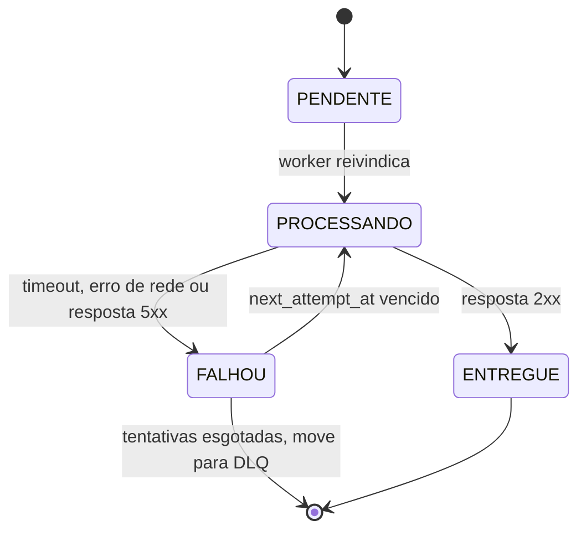
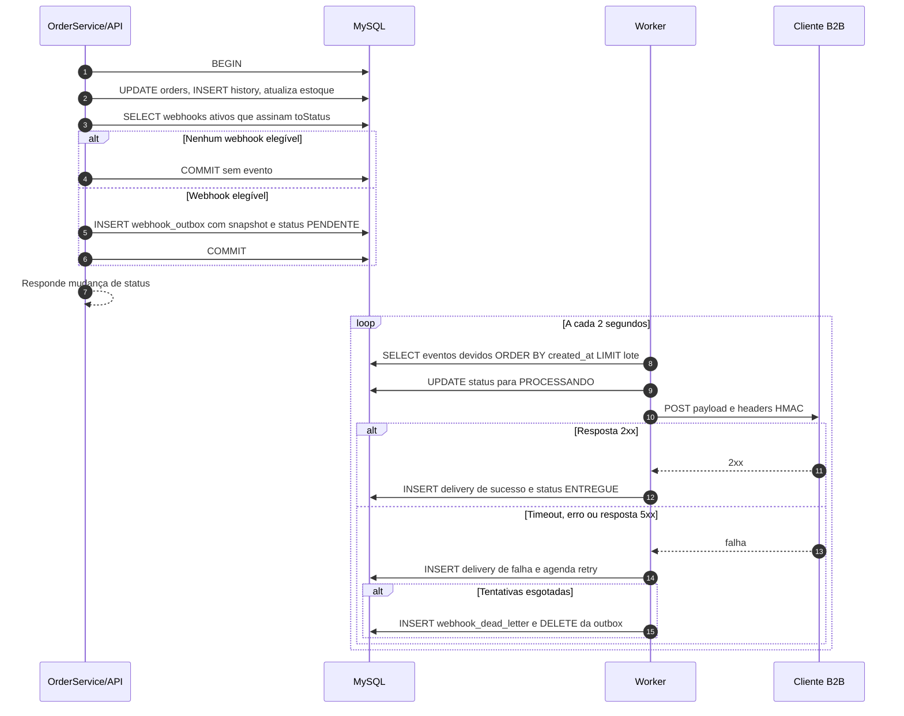

### FDD: Sistema de Webhooks de Notificação de Pedidos

Versão: 1.0
Data: 23/10/2026
Responsável: Larissa (Tech Lead)

As citações no formato [hh:mm] Nome indicam a fala da transcrição que sustenta a decisão. Itens marcados como inferência ou hipótese não são decisões fechadas.

---

### 1. Contexto e motivação técnica

**Problema técnico**

Os clientes B2B consultam `GET /orders` periodicamente para descobrir mudanças de status. Esse polling torna a integração lenta e cara para o cliente e não garante que toda mudança seja observada. A feature adiciona notificação outbound de mudanças de status para endpoints HTTPS cadastrados pelos clientes.

A alternativa de disparar a chamada HTTP dentro de `OrderService.changeStatus` foi descartada. A transação já atualiza `orders`, insere em `order_status_history` e altera `stock_quantity` dos produtos. Uma chamada HTTP dentro dela acoplaria a latência e a disponibilidade do cliente à mudança de status. Se o cliente estivesse indisponível, não seria possível reverter a mudança de status apenas por causa da notificação. [09:04] Bruno, [09:06] Diego.

A solução adotada é o padrão outbox no MySQL. A linha de evento é inserida na mesma transação SQL que confirma a mudança de status. Um worker separado lê a outbox e executa as chamadas HTTP. Se a transação principal confirmar, o evento existe. Se ela reverter, o evento desaparece junto. [09:06] Diego, [09:40] Bruno, [09:41] Diego.

**Encaixe no HLD**

O OMS é uma aplicação Node.js, TypeScript, Express, Prisma e MySQL. A feature não cria um novo sistema: adiciona um módulo em `src/modules/webhooks`, tabelas no MySQL existente, uma entrypoint `src/worker.ts` e o script `npm run worker`, que ainda não existem. O worker usa o mesmo banco e a mesma stack, mas roda em processo separado da API. [09:11] Larissa, [09:11] Bruno, [09:11] Diego, [09:28] Bruno.

A API existente monta as rotas sob `/api/v1` em `src/app.ts:67`. Os novos endpoints devem ser montados nesse mesmo prefixo. O worker não expõe HTTP para o cliente e não compartilha o processo da API. [09:11] Diego, [09:28] Bruno.

Não entram Redis Streams, fila externa, trigger do banco como notificador, envio síncrono nem webhooks inbound. O MySQL existente resolve a persistência e o polling atende ao requisito de latência abaixo de 10 segundos. [09:02] Marcos, [09:07] Larissa, [09:07] Diego, [09:09] Diego.

**Atores e componentes**

| Ator ou componente | Responsabilidade |
| --- | --- |
| Cliente B2B e endpoint HTTPS | Receber a chamada HTTP, validar a assinatura HMAC-SHA256 e deduplicar pelo `X-Event-Id`. |
| Usuário autenticado do OMS | Criar, listar, editar, remover webhooks, rotacionar secret e consultar entregas. |
| Usuário com role ADMIN | Executar replay manual de evento da DLQ. |
| `OrderService` e API Express | Validar a mudança de status e inserir o evento na outbox dentro da transação. |
| Worker | Consultar a outbox, entregar HTTP, aplicar retry e mover falhas permanentes para a DLQ. |
| MySQL | Persistir configuração, assinaturas de status, outbox, entregas e DLQ. |
| Operação e segurança | Monitorar backlog, revisar HMAC e geração de secret antes do deploy. |

**Limites e fronteiras**

- A feature é somente outbound. O OMS envia eventos para o cliente e não recebe eventos do cliente. [09:02] Sofia, [09:02] Marcos.
- O `customerId` é explícito no body ou no path. A sugestão inicial de obtê-lo do JWT foi corrigida na reunião, porque o JWT atual representa o usuário operador, não o cliente. [09:31] Marcos, [09:32] Bruno, [09:32] Larissa.
- O CRUD de configuração e a consulta de entregas exigem autenticação, mas não exigem role específica nesta fase. O replay de DLQ exige `ADMIN`. [09:36] Larissa, [09:37] Sofia.
- O payload é um snapshot renderizado no momento da inserção na outbox. Alterações posteriores no pedido não alteram o evento. [09:51] Bruno, [09:52] Larissa, [09:52] Diego.
- O evento não inclui itens do pedido. Detalhes adicionais ficam disponíveis em `GET /orders/:id`. [09:43] Diego, [09:44] Bruno.
- Não há dashboard visual para o cliente nesta fase. A integração é feita pelos endpoints da API e pela documentação no portal do desenvolvedor. [09:39] Marcos, [09:40] Larissa.

**Restrições e suposições**

| Item | Definição |
| --- | --- |
| Outbox | MySQL existente, IDs UUID, inserção atômica com `changeStatus`, índices em status e `created_at`. |
| Worker | Processo separado, polling a cada 2 segundos, single-worker, leitura em lote pequeno. |
| Entrega | At-least-once, `X-Event-Id` UUID para deduplicação no cliente, timeout HTTP de 10 segundos. |
| Retry | 1 tentativa inicial + 5 retentativas (6 chamadas) com backoff 1m/5m/30m/2h/12h, seguidas de DLQ em tabela separada. |
| Segurança | HMAC-SHA256 sobre o corpo, secret única por endpoint, rotação com grace period de 24 horas, URL somente HTTPS. |
| Payload | Máximo de 64KB, sem truncamento, com erro acima do limite. |
| Filtro | Lista de status assinados por endpoint, aplicada na inserção da outbox. |
| API | Prefixo `/api/v1`, JSON, autenticação JWT Bearer e error middleware centralizado. |

Suposições técnicas:

- O cliente consegue expor um endpoint HTTPS acessível pela saída de rede do OMS, validar HMAC-SHA256 e deduplicar eventos pelo `X-Event-Id`. [09:20] Sofia, [09:25] Diego, [09:26] Marcos.
- A resposta 2xx do cliente significa sucesso da entrega. O corpo da resposta não é usado para decidir sucesso. [09:42] Diego.
- A secret precisa ser recuperável pela API e pelo worker para calcular o HMAC. Hash de mão única não atende. O formato, o tamanho e a criptografia em repouso não foram definidos na transcrição.
- O relógio do OMS é a referência para o timestamp do evento e para o `X-Timestamp`. Sincronismo de relógio com o cliente não foi discutido.

---

### 2. Objetivos técnicos

| Objetivo | Medida ou invariante |
| --- | --- |
| Garantir atomicidade entre status e evento | 100% das mudanças de status elegíveis têm evento na outbox se e somente se a transação confirmar. Falha de insert reverte a mudança de status. |
| Entregar em tempo quase real | Latência entre o commit da mudança de status e a resposta 2xx do cliente menor que 10 segundos em condição normal. O percentil não foi definido na transcrição. |
| Não perder eventos silenciosamente | Todo evento elegível fica persistido na outbox, é entregue ou termina na DLQ após esgotar as tentativas. |
| Isolar o processamento da API | Worker roda em processo separado. Reinício da API não interrompe o worker, e reinício do worker não perde eventos persistidos. |
| Respeitar a assinatura de status | Nenhuma linha de outbox é criada quando nenhum webhook ativo do customer assina o `toStatus`. |
| Proteger a entrega | 100% das entregas usam HTTPS, HMAC-SHA256 e secret única por endpoint. Hipótese de segurança: a secret não aparece em logs nem em respostas de listagem. |
| Garantir at-least-once | Todo evento pode ser entregue mais de uma vez. O `X-Event-Id` é estável entre retries e permite deduplicação no cliente. |
| Preservar a ordem por pedido | Enquanto houver um único worker, eventos de um mesmo `order_id` são processados na ordem de `created_at`. Não há garantia de ordering global. O retry pode quebrar essa ordem; ver o risco correspondente na seção 10. |
| Manter payload imutável | O payload é um snapshot da mudança de status, com no máximo 64KB, sem itens do pedido. |
| Oferecer histórico | Cada endpoint retorna as últimas 100 tentativas de entrega com sucesso ou falha, payload, resposta e tempo. Cada tentativa HTTP é uma linha; retries do mesmo evento aparecem separados. |
| Permitir recuperação operacional | Eventos da DLQ podem ser recolocados na outbox por um usuário ADMIN, com registro de auditoria. |
| Preservar compatibilidade | A máquina de estados, as transições, o débito e a reposição de estoque e o contrato atual de `changeStatus` não mudam. |

Observação sobre latência: o polling de 2 segundos e o timeout HTTP de 10 segundos são decisões confirmadas. O timeout de 10 segundos pode fazer uma entrega lenta ultrapassar a meta de 10 segundos. A meta vale para entregas bem-sucedidas em condição normal, não para o pior caso de cliente lento. [09:10] Larissa, [09:42] Diego.

---

### 3. Escopo e exclusões

**Incluído**

- CRUD autenticado de configuração de webhook por customer, com URL, lista de status assinados e estado ativo. [09:31] Marcos, [09:33] Bruno.
- Geração de secret única por endpoint na criação, com retorno da secret na resposta de criação. [09:21] Sofia, [09:31] Marcos.
- Rotação de secret pela API, com a secret anterior válida por 24 horas em paralelo. [09:21] Sofia, [09:22] Sofia.
- Validação de URL somente HTTPS. [09:23] Sofia.
- Filtro de status na inserção da outbox. [09:33] Marcos, [09:34] Bruno, [09:34] Diego.
- Inserção de evento na `webhook_outbox` dentro da transação de `changeStatus`. [09:40] Bruno, [09:41] Diego.
- Payload snapshot com `event_id`, `event_type`, `timestamp`, `order_id`, `order_number`, `from_status`, `to_status`, `customer_id` e `total_cents`. [09:43] Diego.
- Worker em processo separado, polling a cada 2 segundos, processamento em lote pequeno e timeout HTTP de 10 segundos. [09:09] Diego, [09:11] Diego, [09:42] Diego.
- Retry com 1 tentativa inicial + 5 retentativas (6 chamadas) e backoff 1m/5m/30m/2h/12h, com DLQ em tabela separada. [09:17] Larissa, [09:18] Diego.
- Entrega at-least-once com `X-Event-Id` para deduplicação. [09:26] Larissa.
- Assinatura HMAC-SHA256 sobre o corpo e headers `X-Signature`, `X-Timestamp`, `X-Webhook-Id`, `X-Event-Id` e `Content-Type: application/json`. [09:20] Sofia, [09:25] Diego, [09:44] Diego, [09:44] Sofia.
- Limite de payload de 64KB, com erro acima do limite e sem truncamento. [09:23] Sofia, [09:24] Diego, [09:24] Larissa.
- Consulta das últimas 100 tentativas de entrega por endpoint em `GET /webhooks/:id/deliveries`. [09:34] Marcos.
- Replay manual de DLQ em `POST /admin/webhooks/dead-letter/:id/replay`, restrito a ADMIN e auditado. [09:18] Diego, [09:35] Diego, [09:36] Sofia, [09:36] Larissa.
- Reuso de `AppError`, Pino, error middleware, Zod, `requireRole`, padrão de módulos e códigos `WEBHOOK_*`. [09:28] Bruno, [09:29] Bruno, [09:29] Larissa, [09:30] Larissa.
- Observabilidade com logs estruturados; métricas e tracing são hipóteses a validar, detalhadas na seção 7. A transcrição confirma o reuso do Pino, não a instrumentação de métricas ou tracing.

**Excluído**

- Envio síncrono dentro da transação de mudança de status. Uma falha do cliente não pode reverter a mudança de status. [09:04] Bruno, [09:06] Diego.
- Redis Streams, fila externa, Redis Cluster ou qualquer nova infraestrutura de mensageria. [09:07] Larissa, [09:07] Diego.
- Trigger do banco como mecanismo de notificação do worker. O MySQL não tem listener nativo para processo externo. [09:09] Bruno, [09:09] Diego.
- Garantia exactly-once. A garantia adotada é at-least-once com deduplicação no cliente. [09:25] Diego, [09:26] Larissa.
- Retry com 3 tentativas ou retry infinito. Três é insuficiente para indisponibilidades planejadas e infinito deixa evento pendurado. [09:15] Diego, [09:16] Bruno, [09:16] Diego.
- Webhooks inbound, ou seja, eventos enviados pelo cliente para o OMS. [09:02] Marcos, [09:03] Sofia.
- Fallback por email para clientes com webhook falhando. Fica para uma próxima fase. [09:37] Marcos, [09:37] Larissa.
- Rate limiting de saída nesta fase. O tema será observado e decidido depois. [09:39] Diego, [09:39] Larissa.
- Dashboard visual para o cliente. Painel é projeto separado do time de frontend. [09:39] Marcos, [09:40] Larissa.
- Arquivamento de eventos entregues após 30 dias. Fica fora do escopo desta feature. [09:08] Diego.
- Múltiplos workers em paralelo e garantia de ordering global. O particionamento por `order_id` ou lock pessimista fica para o futuro. [09:13] Diego, [09:13] Larissa.
- Truncamento de payload acima de 64KB. O comportamento decidido é erro. [09:23] Sofia, [09:24] Larissa.
- Secret global da plataforma. A secret é única por endpoint. [09:21] Sofia.

---

### 4. Fluxos detalhados e diagramas

**Fluxo principal 1: cadastro de webhook**

1. A API recebe `POST /api/v1/webhooks` com JWT válido no header `Authorization`.
2. O middleware `authenticate` valida o token e preenche `req.user` com `id`, `email` e `role`. O código existente está em `src/middlewares/auth.middleware.ts:27`.
3. O middleware `validate` aplica o schema Zod do body. Campos previstos: `customerId`, `url` e lista de status assinados. O nome exato do campo da lista não foi definido na transcrição; este FDD usa `subscribedStatuses` como proposta. [09:31] Marcos, [09:33] Bruno.
4. O service valida que o customer existe. Customer inexistente retorna 404.
5. A URL é interpretada com `new URL`. O protocolo deve ser `https:`. `http:` ou formato inválido retorna erro de validação 400. [09:23] Sofia.
6. Cada status informado é validado contra o enum `OrderStatus` do Prisma. Status inválido retorna erro de validação 400. [09:33] Bruno.
7. A API gera uma secret única para o endpoint. Formato, tamanho e codificação não foram definidos; uma hipótese segura é usar `crypto.randomBytes(32)` com codificação base64url ou hexadecimal, a validar com a Sofia. [09:21] Sofia.
8. A configuração é persistida com `customerId`, `url`, secret vigente, estado ativo e assinaturas de status.
9. A resposta 201 retorna a configuração criada e a secret. Hipótese de segurança: a secret não deve ser retornada em listagens, leituras ou edições posteriores. [09:31] Marcos, [09:22] Sofia.
10. Se a persistência falhar, nenhuma configuração é criada e o error middleware retorna o erro padronizado.

**Fluxo principal 2: mudança de status e enfileiramento**

1. A API recebe a mudança de status existente em `PATCH /api/v1/orders/:id/status`.
2. `OrderService.changeStatus` abre a transação em `this.prisma.$transaction` no arquivo `src/modules/orders/order.service.ts:131`.
3. A transação carrega o pedido e os itens, valida a transição com `canTransition` e aplica as regras existentes de débito e reposição de estoque em `src/modules/orders/order.status.ts`.
4. A transação atualiza `orders` em `src/modules/orders/order.service.ts:158` e insere o histórico em `src/modules/orders/order.service.ts:159`.
5. Antes do commit, `changeStatus` chama a função interna `publishWebhookEvent(tx, order, fromStatus, toStatus)`, passando o client transacional. A função não pode usar o `PrismaClient` global. [09:41] Bruno, [09:41] Diego.
6. A função consulta os webhooks ativos do `customerId` do pedido que assinam o status de destino. A consulta usa a configuração e a lista de status assinados dentro da mesma transação.
7. Se nenhum webhook elegível existir, a função retorna sem inserir nada. [09:34] Bruno, [09:34] Diego.
8. Para cada webhook elegível, a função renderiza o snapshot do payload com `event_id` UUID, `event_type` `order.status_changed`, timestamp ISO 8601, dados do pedido e `from_status`/`to_status`. [09:43] Diego, [09:52] Larissa.
9. O payload serializado é validado contra o limite de 64KB. O comportamento em caso de excesso está pendente: este FDD propõe erro e rollback da transação para preservar a invariante de que status confirmado tem evento. [09:23] Sofia, [09:24] Larissa.
10. A função insere uma linha em `webhook_outbox` por webhook elegível, com status `PENDENTE`, tentativas zeradas, payload snapshot e referência ao webhook.
11. A transação confirma. Se qualquer insert ou validação da outbox falhar, a transação inteira reverte e a mudança de status não é persistida. [09:40] Bruno, [09:41] Diego.
12. A resposta de `changeStatus` permanece a mesma: o pedido atualizado com itens, histórico e customer. [CODIGO: `src/modules/orders/order.service.ts:169`]
13. Inferência: o fluxo de criação de pedido em `src/modules/orders/order.service.ts:50` não gera evento, porque a transcrição trata apenas de mudanças de status e a criação já nasce em `PENDING`.

**Fluxo principal 3: processamento e entrega pelo worker**

1. `src/worker.ts` é a entrypoint separada. Ela cria um `PrismaClient` próprio com `createPrismaClient()` de `src/config/database.ts:4` e usa a mesma `DATABASE_URL`. [09:11] Diego, [09:30] Bruno.
2. O worker inicia um loop de polling com intervalo de 2 segundos. O intervalo é uma decisão confirmada; a configuração por variável de ambiente é uma hipótese de implementação. [09:09] Diego, [09:10] Larissa.
3. A cada ciclo, o worker busca eventos devidos: status `PENDENTE` ou `FALHOU` com `next_attempt_at` menor ou igual ao horário atual, ordenados por `created_at` ascendente, limitados a um lote pequeno. O tamanho do lote não foi definido; este FDD propõe um valor configurável, por exemplo 20. [09:08] Diego, [09:09] Diego.
4. Os eventos são processados sequencialmente no single-worker. Processamento paralelo dentro do lote quebraria a ordering por `order_id`. [09:12] Diego, [09:13] Larissa.
5. Para cada evento, o worker marca o status como `PROCESSANDO`, carrega a configuração do webhook e a secret vigente, e verifica se o endpoint continua ativo.
6. O worker serializa o payload snapshot, calcula o HMAC-SHA256 sobre o corpo bruto com a secret do endpoint e monta os headers. [09:20] Sofia, [09:44] Diego.
7. O worker executa `POST` para a URL HTTPS do cliente com timeout de 10 segundos. O método POST é uma inferência do formato de webhook com corpo JSON; a transcrição não dita o método explicitamente. [09:42] Diego.
8. Resposta 2xx: o worker registra a entrega bem-sucedida, marca o evento como `ENTREGUE` e libera o próximo evento.
9. Timeout, erro de rede ou resposta 5xx: o worker registra a tentativa com status HTTP, resposta e duração, incrementa o contador e aplica retry. Resposta 4xx: registra a falha; a política de retry para 4xx está pendente. [09:42] Diego.
10. Se a 5ª retentativa falhar, o worker move o evento para `webhook_dead_letter` em uma transação que insere na DLQ e remove o evento da fila ativa. [09:18] Diego.
11. O worker grava logs estruturados com `event_id`, `webhook_id`, `order_id`, tentativa, status HTTP, duração e resultado. [09:29] Bruno.

**Fluxo principal 4: retry e DLQ**

A progressão de backoff confirmada é 1 minuto, 5 minutos, 30 minutos, 2 horas e 12 horas. A transcrição diz 5 tentativas e lista cinco intervalos. Este FDD adota 1 tentativa inicial mais 5 retentativas, totalizando até 6 chamadas HTTP, porque essa leitura usa o intervalo de 12 horas e fecha o total de quase 15 horas citado na reunião. A tabela abaixo conta a tentativa inicial como chamada 1; as chamadas 2 a 6 são as 5 retentativas. [09:17] Diego.

| Falha após a chamada | Espera antes da próxima chamada | Próxima tentativa |
| --- | --- | --- |
| 1 | 1 minuto | 2 |
| 2 | 5 minutos | 3 |
| 3 | 30 minutos | 4 |
| 4 | 2 horas | 5 |
| 5 | 12 horas | 6 |
| 6 | Sem nova tentativa | Move para a DLQ |

A leitura alternativa de 5 chamadas totais deixaria o intervalo de 12 horas sem uso e não fecharia as quase 15 horas citadas; por isso não é adotada. A decisão está registrada no critério 13. [09:15] Diego, [09:16] Bruno, [09:17] Larissa.

O tempo total entre a primeira falha e a última retentativa é de aproximadamente 14 horas e 36 minutos, citado na reunião como quase 15 horas. [09:17] Diego.

A DLQ armazena o payload, o motivo da falha e o timestamp. Este FDD propõe também `event_id`, `webhook_id`, número de tentativas e última resposta para permitir diagnóstico e replay. [09:18] Diego.

**Fluxo principal 5: rotação de secret**

1. O cliente autenticado chama o endpoint de rotação do webhook. A transcrição confirma a existência do endpoint, mas não define o caminho. Este FDD propõe `POST /api/v1/webhooks/:id/rotate-secret`. [09:21] Sofia.
2. O service valida a existência do webhook e gera uma nova secret.
3. A secret anterior é preservada com expiração em 24 horas. A secret nova passa a ser a vigente. [09:21] Sofia, [09:22] Sofia.
4. A resposta retorna a nova secret. A secret anterior não é retornada.
5. Durante 24 horas, a secret anterior permanece válida em paralelo. O formato exato dessa convivência no header `X-Signature` não foi definido na transcrição. As opções são enviar duas assinaturas no mesmo header, usar headers adicionais ou o cliente aceitar as duas secrets. A decisão precisa ser fechada antes da integração. [09:22] Sofia.
6. Hipótese: após 24 horas, a secret anterior deixa de ser aceita e o worker passa a assinar somente com a secret vigente.

**Fluxo principal 6: consulta de entregas**

1. O cliente autenticado chama `GET /api/v1/webhooks/:id/deliveries`. O caminho é confirmado na transcrição. [09:34] Marcos.
2. O service valida a existência do webhook.
3. O service busca as últimas 100 tentativas de entrega do endpoint, da mais recente para a mais antiga. Cada tentativa HTTP é uma linha; retries do mesmo evento aparecem separados.
4. A resposta inclui sucesso ou falha, payload, resposta do cliente e tempo de resposta. [09:34] Marcos.
5. Webhook sem entregas retorna lista vazia. Webhook inexistente retorna 404.

**Fluxo principal 7: replay de DLQ**

1. Um usuário autenticado com role ADMIN chama `POST /api/v1/admin/webhooks/dead-letter/:id/replay`. [09:18] Diego, [09:35] Diego.
2. A rota usa `authenticate` e `requireRole('ADMIN')`. Usuário sem role ADMIN recebe 403. [09:36] Larissa, [09:36] Sofia.
3. O service valida a existência do evento na DLQ. Evento inexistente retorna 404.
4. O evento é recolocado na outbox como pendente. O `event_id` original deve ser preservado para que o cliente deduplique corretamente; essa preservação é uma inferência técnica, não uma decisão explícita da reunião. [09:25] Diego.
5. O service registra em log quem executou o replay, quando, qual evento e qual webhook. [09:36] Sofia, [09:36] Larissa.
6. A resposta confirma o replay. O status HTTP e o formato exato da resposta não foram definidos; este FDD propõe 200 com identificadores do evento e da linha da outbox.

**Persistência e estruturas de dados**

Os nomes `webhook_outbox` e `webhook_dead_letter` são confirmados na transcrição. Os demais nomes são propostas de modelagem e precisam ser validados na revisão técnica. [09:06] Diego, [09:18] Diego.

| Tabela proposta | Campos principais | Índices e observações |
| --- | --- | --- |
| `webhook_endpoints` | `id` UUID, `customer_id`, `url`, `secret_current`, `secret_previous`, `secret_previous_expires_at`, `active`, `created_at`, `updated_at` | Chave estrangeira para `customers`. A secret precisa ser recuperável para o HMAC; criptografia em repouso não foi definida. [09:21] Sofia. |
| `webhook_subscriptions` | `id`, `webhook_id`, `status` | Único por `webhook_id` e `status`. Alternativa: uma coluna JSON com a lista de status. A escolha não foi definida. [09:33] Bruno. |
| `webhook_outbox` | `id` UUID, `event_id` UUID, `webhook_id`, `order_id`, `payload` JSON, `status`, `attempt_count`, `next_attempt_at`, `processing_started_at`, `last_error`, `created_at`, `updated_at` | Índices em `status` e `created_at`, além de `next_attempt_at`, `order_id` e `webhook_id`. O status usa pendente, processando, falhou e entregue. [09:06] Diego, [09:08] Diego, [09:51] Larissa. |
| `webhook_deliveries` | `id` UUID, `outbox_id`, `webhook_id`, `event_id`, `attempt`, `success`, `http_status`, `response_body`, `duration_ms`, `error_code`, `created_at` | Índice em `webhook_id` e `created_at` para retornar as últimas 100. Nome proposto; a tabela não foi nomeada na reunião. [09:34] Marcos. |
| `webhook_dead_letter` | `id` UUID, `event_id`, `webhook_id`, `payload` JSON, `failure_reason`, `attempts`, `last_response`, `created_at` | Tabela separada confirmada. Payload, motivo e timestamp confirmados; campos adicionais são propostas. [09:18] Diego. |

Decisões de modelagem pendentes:

- A relação entre `webhook_outbox.event_id` e o `id` da linha da outbox não foi definida. Este FDD propõe separar os dois: `id` identifica a linha e `event_id` identifica o evento entregue, preservando o mesmo `event_id` em retries e replay.
- O comportamento de chave estrangeira com `orders` não foi definido. Como o pedido pode ser removido em `PENDING` ou `CANCELLED`, uma FK com cascade poderia apagar eventos ainda necessários. A recomendação é não usar cascade e preservar o snapshot.
- O status `falhou` na outbox é usado por este FDD para indicar evento aguardando retry. O evento terminal por esgotamento sai da outbox e vai para a DLQ. Essa semântica não foi discutida explicitamente. [09:18] Diego.

**Máquina de estados da outbox**



Observação: o status `ENTREGUE` da outbox não é o status `DELIVERED` do pedido. São enums diferentes, em tabelas diferentes. O nome deve deixar essa distinção explícita no código.

Observação: o diagrama mostra as transições para 5xx, timeout e erro de rede. A transição para 4xx depende da política de retry, ainda pendente.

**Diagrama de sequência**



**Fluxos alternativos e exceções**

- Nenhum webhook do customer assina o status de destino: nenhum evento é inserido. [09:34] Bruno.
- Webhook existe, mas está inativo: o comportamento não foi definido. Este FDD propõe não inserir evento para endpoint inativo no momento da mudança de status. Se o endpoint for desativado depois da inserção, a decisão permanece pendente.
- Vários webhooks do mesmo customer assinam o mesmo status: este FDD propõe uma linha de outbox por webhook. A transcrição não define se o `event_id` deve ser igual ou distinto entre endpoints. [09:21] Sofia.
- Falha ao inserir na outbox: a transação inteira reverte, incluindo a mudança de status. [09:40] Bruno, [09:41] Diego.
- Worker cai antes de chamar o cliente: a linha pode ficar presa em processando. O mecanismo de lease ou recuperação de linhas presas não foi definido; este FDD propõe um `processing_started_at` e uma rotina de requeue após timeout.
- Worker cai depois de receber 2xx e antes de marcar entregue: o evento será reenviado e o cliente pode receber duplicata. A garantia at-least-once cobre esse caso; o cliente deduplica pelo `X-Event-Id`. [09:25] Diego.
- Cliente responde 3xx, 4xx ou 5xx: inferência deste FDD tratar qualquer resposta não 2xx como falha. Para 5xx, aplicar retry. Para 4xx, a política de retry está pendente. [09:42] Diego.
- Timeout de 10 segundos: tratado como falha e retry. [09:42] Diego.
- Payload acima de 64KB: erro, sem truncamento e sem envio. Este FDD propõe falha permanente e DLQ, porque retry não reduz o payload. [09:23] Sofia, [09:24] Larissa.
- Rotação de secret durante um retry: o worker usa a secret vigente no momento do envio. O cliente que ainda só aceita a secret anterior pode falhar até concluir a migração. O formato de convivência das duas secrets está pendente. [09:22] Sofia.
- Webhook removido entre a inserção e a entrega: o comportamento não foi definido. As opções são descartar o evento, mover para DLQ ou marcar como não entregue. A decisão precisa ser fechada.
- Replay de DLQ: recoloca o evento como pendente, preserva o `event_id` e gera nova tentativa. A remoção da linha da DLQ, o reset do contador e a possibilidade de replay duplicado não foram definidos. [09:18] Diego.
- Múltiplos workers iniciados por engano: podem duplicar entregas e quebrar a ordering. O single-worker é uma premissa operacional, não uma trava técnica descrita na reunião. [09:12] Diego, [09:13] Larissa.

---

### 5. Contratos públicos

**Convenções gerais**

- Base da API: `/api/v1`, conforme `src/app.ts:67`.
- Formato: JSON, com `Content-Type: application/json`.
- Autenticação: `Authorization: Bearer <jwt>` em todos os endpoints. O middleware existente é `authenticate`, em `src/middlewares/auth.middleware.ts:27`.
- Autorização: `requireRole('ADMIN')` apenas no replay de DLQ. O código existente está em `src/middlewares/auth.middleware.ts:49`.
- Erros: envelope do middleware centralizado em `src/middlewares/error.middleware.ts:15`:

```json
{
  "error": {
    "code": "WEBHOOK_NOT_FOUND",
    "message": "Webhook not found",
    "details": {}
  }
}
```

- IDs: UUID, no formato usado pelos modelos Prisma existentes.
- Datas: ISO 8601.
- Os caminhos, nomes de campos, status codes e formatos de resposta marcados como propostas não foram ditados literalmente na transcrição. Eles seguem o padrão do projeto e precisam ser confirmados na revisão.

**POST /api/v1/webhooks**

- Tipo: endpoint HTTP.
- Rota: `/api/v1/webhooks`. O prefixo é confirmado; o caminho do recurso é inferido do módulo `/webhooks`.
- Método: POST. Confirmado na transcrição. [09:31] Marcos.
- Autenticação: JWT Bearer.
- Grau de confirmação: parcial. Método, campos conceituais, secret gerada e `customerId` explícito são confirmados; nomes exatos de campos e formato da resposta são propostas.
- Semântica de status:
  - 201: webhook criado. A resposta inclui a secret gerada.
  - 400: body inválido, URL não HTTPS, status inválido ou lista de status vazia. A rejeição de lista vazia é uma hipótese de validação.
  - 401: ausência ou invalidez de JWT.
  - 404: customer inexistente.
  - 500: falha interna ou de persistência.
- Limites: o body da API é limitado a 1MB pelo `express.json` existente em `src/app.ts:59`. Não há limite específico menor definido para a configuração. O limite de 64KB é do payload do evento outbound.
- Versionamento: `/api/v1`. Não há versionamento por recurso.

Exemplo de requisição:

```json
{
  "customerId": "3f1c2a9e-7b4d-4c1a-9f2e-1a2b3c4d5e6f",
  "url": "https://integracao.atlas.example.com/webhooks/orders",
  "subscribedStatuses": ["SHIPPED", "DELIVERED"]
}
```

Exemplo de resposta 201:

```json
{
  "id": "9b2f7c1a-4d3e-4f5a-8b6c-7d8e9f0a1b2c",
  "customerId": "3f1c2a9e-7b4d-4c1a-9f2e-1a2b3c4d5e6f",
  "url": "https://integracao.atlas.example.com/webhooks/orders",
  "subscribedStatuses": ["SHIPPED", "DELIVERED"],
  "active": true,
  "secret": "<secret-gerada-pela-api>",
  "createdAt": "2026-10-23T12:00:00.000Z",
  "updatedAt": "2026-10-23T12:00:00.000Z"
}
```

Observação: `subscribedStatuses`, `active` e os nomes dos campos de resposta são propostas. Hipótese de segurança: a secret só deve aparecer nessa resposta e na resposta de rotação. [09:31] Marcos, [09:22] Sofia.

**GET /api/v1/customers/:customerId/webhooks**

- Tipo: endpoint HTTP.
- Rota: `/api/v1/customers/:customerId/webhooks`. A transcrição confirma a necessidade de listar os webhooks de um customer, mas não define o caminho. Este FDD adota o customer no path para manter a decisão de que o `customerId` é passado no body ou no path, e não no JWT. A variante com query string fica descartada nesta proposta. [09:32] Larissa, [09:33] Bruno.
- Método: GET.
- Autenticação: JWT Bearer.
- Grau de confirmação: parcial. A listagem por customer é confirmada; a rota por path é uma proposta consistente com a decisão de `customerId` no path; paginação e formato são propostas.
- Semântica de status:
  - 200: lista retornada, possivelmente vazia.
  - 400: `customerId` inválido.
  - 401: JWT ausente ou inválido.
  - 404: customer inexistente, se a implementação validar a existência.
- Limites: não foi definida paginação. Este FDD propõe retornar todos os webhooks do customer nesta fase, ou usar o helper `paginated` existente em `src/shared/http/response.ts:22`.
- Versionamento: `/api/v1`.

Exemplo de requisição:

```http
GET /api/v1/customers/3f1c2a9e-7b4d-4c1a-9f2e-1a2b3c4d5e6f/webhooks HTTP/1.1
Authorization: Bearer <jwt>
```

Exemplo de resposta 200:

```json
{
  "data": [
    {
      "id": "9b2f7c1a-4d3e-4f5a-8b6c-7d8e9f0a1b2c",
      "customerId": "3f1c2a9e-7b4d-4c1a-9f2e-1a2b3c4d5e6f",
      "url": "https://integracao.atlas.example.com/webhooks/orders",
      "subscribedStatuses": ["SHIPPED", "DELIVERED"],
      "active": true,
      "createdAt": "2026-10-23T12:00:00.000Z",
      "updatedAt": "2026-10-23T12:00:00.000Z"
    }
  ]
}
```

Hipótese de segurança: a resposta não inclui a secret. [09:22] Sofia.

**PATCH /api/v1/webhooks/:id**

- Tipo: endpoint HTTP.
- Rota: `/api/v1/webhooks/:id`. Proposta baseada no método PATCH confirmado e no módulo `/webhooks`.
- Método: PATCH. Confirmado na transcrição. [09:33] Bruno.
- Autenticação: JWT Bearer.
- Grau de confirmação: parcial. A edição é confirmada; campos editáveis e formato da resposta são propostas.
- Semântica de status:
  - 200: webhook atualizado.
  - 400: URL inválida, status inválido ou body malformado.
  - 401: JWT ausente ou inválido.
  - 404: webhook inexistente.
  - 409: conflito de unicidade ou estado, se aplicável. Não foi definido na transcrição.
- Limites: os mesmos limites gerais da API.
- Versionamento: `/api/v1`.

Exemplo de requisição:

```json
{
  "url": "https://integracao.atlas.example.com/webhooks/orders-v2",
  "subscribedStatuses": ["PAID", "SHIPPED", "DELIVERED"],
  "active": false
}
```

Exemplo de resposta 200:

```json
{
  "id": "9b2f7c1a-4d3e-4f5a-8b6c-7d8e9f0a1b2c",
  "customerId": "3f1c2a9e-7b4d-4c1a-9f2e-1a2b3c4d5e6f",
  "url": "https://integracao.atlas.example.com/webhooks/orders-v2",
  "subscribedStatuses": ["PAID", "SHIPPED", "DELIVERED"],
  "active": false,
  "createdAt": "2026-10-23T12:00:00.000Z",
  "updatedAt": "2026-10-23T12:05:00.000Z"
}
```

Hipótese de segurança: a secret não é editável por esse endpoint. A rotação tem fluxo próprio. [09:21] Sofia.

**DELETE /api/v1/webhooks/:id**

- Tipo: endpoint HTTP.
- Rota: `/api/v1/webhooks/:id`. Proposta baseada no método DELETE confirmado e no módulo `/webhooks`.
- Método: DELETE. Confirmado na transcrição. [09:33] Bruno.
- Autenticação: JWT Bearer.
- Grau de confirmação: parcial. A remoção é confirmada; o comportamento de exclusão lógica ou física e o destino do histórico são propostas.
- Semântica de status:
  - 204: removido, sem corpo.
  - 401: JWT ausente ou inválido.
  - 404: webhook inexistente.
  - 409: remoção bloqueada por entregas ou DLQ, se essa regra for adotada. Não foi definida.
- Limites: não aplicável.
- Versionamento: `/api/v1`.

Exemplo de requisição:

```http
DELETE /api/v1/webhooks/9b2f7c1a-4d3e-4f5a-8b6c-7d8e9f0a1b2c HTTP/1.1
Authorization: Bearer <jwt>
```

Resposta de sucesso: 204 No Content, sem corpo.

A transcrição não define se o DELETE remove fisicamente a configuração ou apenas marca `active = false`. Como o histórico de entregas e a DLQ podem precisar sobreviver à remoção, a decisão precisa ser fechada. [09:33] Bruno, [09:18] Diego.

**POST /api/v1/webhooks/:id/rotate-secret**

- Tipo: endpoint HTTP.
- Rota: `/api/v1/webhooks/:id/rotate-secret`. A rotação é confirmada, o caminho é uma proposta. [09:21] Sofia.
- Método: POST.
- Autenticação: JWT Bearer.
- Grau de confirmação: parcial. A existência e o grace period de 24 horas são confirmados; caminho, corpo e formato da resposta são propostas.
- Semântica de status:
  - 200: nova secret gerada.
  - 401: JWT ausente ou inválido.
  - 404: webhook inexistente.
  - 500: falha ao persistir a rotação.
- Limites: não aplicável.
- Versionamento: `/api/v1`.

Exemplo de requisição:

```http
POST /api/v1/webhooks/9b2f7c1a-4d3e-4f5a-8b6c-7d8e9f0a1b2c/rotate-secret HTTP/1.1
Authorization: Bearer <jwt>
```

Exemplo de resposta 200:

```json
{
  "id": "9b2f7c1a-4d3e-4f5a-8b6c-7d8e9f0a1b2c",
  "secret": "<nova-secret-gerada>",
  "previousSecretExpiresAt": "2026-10-24T12:00:00.000Z"
}
```

O mecanismo de convivência das duas secrets no header `X-Signature` está pendente. A data de expiração é uma proposta de campo. [09:22] Sofia.

**GET /api/v1/webhooks/:id/deliveries**

- Tipo: endpoint HTTP.
- Rota: `/api/v1/webhooks/:id/deliveries`. Confirmada na transcrição. [09:34] Marcos.
- Método: GET.
- Autenticação: JWT Bearer.
- Grau de confirmação: confirmado para o caminho e para o limite de 100 registros; a interpretação de entrega como tentativa HTTP é uma inferência, e o formato dos campos e a ordenação são propostas.
- Semântica de status:
  - 200: lista retornada, possivelmente vazia.
  - 401: JWT ausente ou inválido.
  - 404: webhook inexistente.
- Limites: últimas 100 tentativas de entrega, entendidas como cada chamada HTTP. Retries do mesmo evento aparecem como linhas separadas. Não há paginação definida. [09:34] Marcos.
- Versionamento: `/api/v1`.

Exemplo de requisição:

```http
GET /api/v1/webhooks/9b2f7c1a-4d3e-4f5a-8b6c-7d8e9f0a1b2c/deliveries HTTP/1.1
Authorization: Bearer <jwt>
```

Exemplo de resposta 200:

```json
{
  "data": [
    {
      "id": "c1d2e3f4-a5b6-4c7d-8e9f-0a1b2c3d4e5f",
      "eventId": "550e8400-e29b-41d4-a716-446655440000",
      "attempt": 1,
      "success": false,
      "httpStatus": 503,
      "payload": {
        "event_id": "550e8400-e29b-41d4-a716-446655440000",
        "event_type": "order.status_changed",
        "timestamp": "2026-10-23T12:00:00.000Z",
        "order_id": "7a8b9c0d-1e2f-4a3b-8c4d-5e6f7a8b9c0d",
        "order_number": "ORD-000123",
        "from_status": "PAID",
        "to_status": "SHIPPED",
        "customer_id": "3f1c2a9e-7b4d-4c1a-9f2e-1a2b3c4d5e6f",
        "total_cents": 25990
      },
      "responseBody": "Service Unavailable",
      "durationMs": 10020,
      "errorCode": "WEBHOOK_DELIVERY_HTTP_ERROR",
      "createdAt": "2026-10-23T12:00:02.000Z"
    }
  ]
}
```

Observação: `responseBody` pode conter dados sensíveis ou conteúdo muito grande. Retenção, truncamento e redaction não foram definidos. [09:34] Marcos.

Interpretação: a transcrição diz `últimos 100 webhooks`. Este FDD adota `últimas 100 tentativas` porque sucesso/falha, response e tempo de resposta são propriedades de cada tentativa HTTP. Se o produto quiser 100 eventos em vez de 100 tentativas, o modelo de `webhook_deliveries` e o contrato precisam ser revistos.

**POST /api/v1/admin/webhooks/dead-letter/:id/replay**

- Tipo: endpoint HTTP.
- Rota: `/api/v1/admin/webhooks/dead-letter/:id/replay`. O caminho `/admin/webhooks/dead-letter/:id/replay` é confirmado; o prefixo `/api/v1` vem da aplicação existente. [09:18] Diego, [09:35] Diego, [09:36] Larissa.
- Método: POST.
- Autenticação: JWT Bearer.
- Autorização: role ADMIN via `requireRole`. [09:36] Larissa, [09:36] Sofia.
- Grau de confirmação: confirmado para caminho, role e auditoria; status HTTP e formato da resposta são propostas.
- Semântica de status:
  - 200: replay aceito e evento recolocado como pendente.
  - 401: JWT ausente ou inválido.
  - 403: usuário autenticado sem role ADMIN.
  - 404: evento não encontrado na DLQ.
  - 409: conflito se o evento já estiver pendente ou entregue. Não foi definido.
  - 500: falha ao reinserir na outbox.
- Limites: não aplicável.
- Versionamento: `/api/v1`.

Exemplo de requisição:

```http
POST /api/v1/admin/webhooks/dead-letter/d4e5f6a7-b8c9-4d0e-8f1a-2b3c4d5e6f7a/replay HTTP/1.1
Authorization: Bearer <jwt>
```

Exemplo de resposta 200:

```json
{
  "replayed": true,
  "deadLetterId": "d4e5f6a7-b8c9-4d0e-8f1a-2b3c4d5e6f7a",
  "outboxId": "e5f6a7b8-c9d0-4e1f-8a2b-3c4d5e6f7a8b",
  "eventId": "550e8400-e29b-41d4-a716-446655440000"
}
```

A auditoria deve registrar o usuário ADMIN, o timestamp, o `deadLetterId`, o `eventId` e o resultado. Um log Pino é o mínimo confirmado; a necessidade de trilha imutável em tabela não foi discutida. [09:36] Sofia.

**publishWebhookEvent, função interna**

- Tipo: função interna.
- Assinatura proposta:

```ts
export async function publishWebhookEvent(
  tx: Prisma.TransactionClient,
  order: Order,
  fromStatus: OrderStatus,
  toStatus: OrderStatus,
): Promise<void>
```

- Grau de confirmação: o nome e a ideia de receber o `tx` são confirmados. Os tipos exatos e o retorno são propostas. [09:41] Bruno, [09:41] Diego.
- Responsabilidade: consultar webhooks ativos do customer que assinam `toStatus`, renderizar o snapshot e inserir uma linha por webhook na `webhook_outbox`.
- Invariante: deve ser chamada exclusivamente dentro da transação de `changeStatus`, com o `tx` recebido. Não pode abrir transação própria nem usar o PrismaClient global.
- Erros: falha de insert ou de validação deve propagar e provocar rollback da transação. [09:40] Bruno.
- Retorno: `void`. A quantidade de eventos inseridos não foi definida como retorno; se for necessária para logs ou testes, pode ser obtida por contagem interna sem alterar o contrato transacional.

Exemplo de chamada dentro de `changeStatus`:

```ts
await tx.order.update({ where: { id }, data: { status: to } });
await tx.orderStatusHistory.create({
  data: {
    orderId: id,
    fromStatus: from,
    toStatus: to,
    changedById: userId,
    reason: input.reason ?? null,
  },
});

await publishWebhookEvent(tx, order, from, to);

const refreshed = await tx.order.findUnique({
  where: { id },
  include: {
    items: { include: { product: { select: { id: true, sku: true, name: true } } } },
    history: { orderBy: { changedAt: 'asc' } },
    customer: { select: { id: true, name: true, email: true } },
  },
});
```

O exemplo é ilustrativo e não substitui a implementação real. O objeto `order` carregado antes do update contém os campos do snapshot; `toStatus` é passado explicitamente. [CODIGO: `src/modules/orders/order.service.ts:131`]

**Entrega HTTP ao cliente**

- Tipo: endpoint outbound.
- URL: a URL HTTPS cadastrada no webhook.
- Método: POST. A transcrição fala em chamada HTTP com corpo e headers, mas não dita o método; POST é a inferência padrão para webhook. [09:44] Diego.
- Autenticação do cliente: HMAC-SHA256 no header `X-Signature`, calculado sobre o corpo bruto da requisição com a secret do endpoint. [09:20] Sofia.
- Grau de confirmação: parcial. Headers, campos do payload, timeout e garantia at-least-once são confirmados; método, formato da assinatura, formato do timestamp e comportamento de redirect são inferências ou lacunas.

Headers:

| Header | Semântica | Formato |
| --- | --- | --- |
| `X-Signature` | HMAC-SHA256 do corpo bruto com a secret do endpoint. | Formato não definido. Pode ser hexadecimal ou base64, com ou sem prefixo. [09:20] Sofia. |
| `X-Timestamp` | Timestamp do envio, para o cliente detectar replay se quiser. | Formato não definido. ISO 8601 é uma hipótese. [09:44] Diego. |
| `X-Webhook-Id` | ID do cadastro de webhook que originou o envio. | UUID. [09:44] Sofia. |
| `X-Event-Id` | ID do evento, estável entre retries e replay. | UUID. [09:25] Diego. |
| `Content-Type` | Tipo do corpo. | `application/json`. [09:44] Diego. |

Payload confirmado:

| Campo | Tipo | Origem |
| --- | --- | --- |
| `event_id` | UUID | Gerado quando o evento entra na outbox. [09:25] Diego. |
| `event_type` | string | Valor fixo `order.status_changed`. [09:43] Diego. |
| `timestamp` | ISO 8601 | Momento do evento na outbox. [09:43] Diego. |
| `order_id` | UUID | Pedido que mudou de status. [09:43] Diego. |
| `order_number` | string | Número do pedido. [09:43] Diego. |
| `from_status` | enum | Status anterior. [09:43] Diego. |
| `to_status` | enum | Status novo. [09:43] Diego. |
| `customer_id` | UUID | Customer do pedido. [09:43] Diego. |
| `total_cents` | inteiro | Total do pedido em centavos. [09:43] Diego. |

O payload não inclui itens do pedido. [09:43] Diego, [09:44] Bruno.

Exemplo de requisição outbound:

```http
POST /webhooks/orders HTTP/1.1
Host: integracao.atlas.example.com
Content-Type: application/json
X-Signature: <hmac-sha256-do-corpo>
X-Timestamp: 2026-10-23T12:00:02.000Z
X-Webhook-Id: 9b2f7c1a-4d3e-4f5a-8b6c-7d8e9f0a1b2c
X-Event-Id: 550e8400-e29b-41d4-a716-446655440000

{
  "event_id": "550e8400-e29b-41d4-a716-446655440000",
  "event_type": "order.status_changed",
  "timestamp": "2026-10-23T12:00:00.000Z",
  "order_id": "7a8b9c0d-1e2f-4a3b-8c4d-5e6f7a8b9c0d",
  "order_number": "ORD-000123",
  "from_status": "PAID",
  "to_status": "SHIPPED",
  "customer_id": "3f1c2a9e-7b4d-4c1a-9f2e-1a2b3c4d5e6f",
  "total_cents": 25990
}
```

Semântica de resposta:

- 2xx: sucesso. O corpo da resposta é ignorado para a decisão de sucesso.
- 3xx: não definido. Este FDD propõe não seguir redirects e tratar como falha, para evitar downgrade de HTTPS e SSRF.
- 4xx: falha. A política de retry para 4xx está pendente; a transcrição não define o comportamento.
- 5xx: falha e retry.
- Timeout de 10 segundos: falha e retry. [09:42] Diego.

Limites:

- Payload máximo de 64KB, sem truncamento. [09:24] Larissa.
- Timeout de 10 segundos por chamada. [09:42] Diego.
- Sem rate limiting de saída nesta fase. O tema fica em observação. [09:39] Larissa.
- Sem garantia exactly-once. [09:25] Diego.

Versionamento:

- O payload não tem campo de versão. `event_type` é o único discriminador confirmado. A inclusão de um campo de versão ou de um header de versão não foi discutida e fica pendente.
- A API usa `/api/v1`. [CODIGO: `src/app.ts:67`]

---

### 6. Erros, exceções e fallback

**Matriz de erros do módulo**

Os códigos abaixo seguem o prefixo `WEBHOOK_` decidido na reunião. Apenas `WEBHOOK_NOT_FOUND`, `WEBHOOK_INVALID_URL` e `WEBHOOK_SECRET_REQUIRED` foram citados como exemplos. Os demais nomes são propostas de nomenclatura a confirmar. [09:28] Bruno, [09:29] Larissa.

| Condição | Tratamento | Observações |
| --- | --- | --- |
| `WEBHOOK_NOT_FOUND` (404): webhook inexistente no CRUD, na rotação ou nas entregas. | Retornar 404 com `AppError` e código estável. | Reutiliza o padrão de `NotFoundError` de `src/shared/errors/http-errors.ts:27`. [09:28] Bruno. |
| `WEBHOOK_INVALID_URL` (400): URL ausente, malformada ou com protocolo diferente de HTTPS. | Rejeitar na validação Zod ou no service e retornar 400. | Confirmado que HTTP é recusado. [09:23] Sofia. |
| `WEBHOOK_INVALID_STATUS` (400): status fora do enum `OrderStatus` ou lista vazia. | Rejeitar e retornar 400. | A rejeição de lista vazia é uma hipótese. [09:33] Bruno. |
| `WEBHOOK_CUSTOMER_REQUIRED` (400): `customerId` ausente no body ou no path. | Rejeitar e retornar 400. | O `customerId` não vem do JWT. [09:32] Larissa. |
| `WEBHOOK_CUSTOMER_NOT_FOUND` (404): customer informado não existe. | Retornar 404. | A feature não cria customer. [09:31] Marcos. |
| `WEBHOOK_SECRET_REQUIRED` (500): tentativa interna de persistir ou usar endpoint sem secret. | Falhar a operação e não persistir configuração inválida. | Código citado como exemplo na transcrição. [09:28] Bruno. |
| `WEBHOOK_PAYLOAD_TOO_LARGE` (422 ou 413): payload serializado acima de 64KB. | Não truncar. Retornar erro e não enviar. Se a validação ocorrer no worker, este FDD propõe falha permanente e DLQ. | O status HTTP não foi definido. O limite é confirmado. [09:24] Larissa. |
| `WEBHOOK_OUTBOX_WRITE_FAILED` (500): falha ao inserir na outbox. | Propagar o erro e reverter a transação de `changeStatus`. | Preserva a invariante de atomicidade. [09:40] Bruno. |
| `WEBHOOK_PAYLOAD_RENDER_FAILED` (500): falha ao montar ou serializar o snapshot. | Reverter a transação de `changeStatus`. | Hipótese de implementação para preservar atomicidade. |
| `WEBHOOK_DELIVERY_TIMEOUT` (interno): cliente não respondeu em 10 segundos. | Registrar falha e aplicar retry. | Timeout confirmado. [09:42] Diego. |
| `WEBHOOK_DELIVERY_HTTP_ERROR` (interno): resposta não 2xx. | Registrar status, resposta e duração. Para 5xx, aplicar retry. Para 4xx, a política está pendente. | A transcrição não detalha non-2xx. A distinção entre 4xx e 5xx precisa ser fechada. |
| `WEBHOOK_DELIVERY_NETWORK_ERROR` (interno): DNS, TLS, conexão recusada ou erro de rede. | Registrar falha e aplicar retry. | Coberto pela política de resiliência. |
| `WEBHOOK_RETRY_EXHAUSTED` (interno): tentativas esgotadas. | Mover o evento para `webhook_dead_letter` e remover da outbox ativa. | DLQ em tabela separada confirmada. [09:18] Diego. |
| `WEBHOOK_DEAD_LETTER_NOT_FOUND` (404): evento de DLQ inexistente no replay. | Retornar 404. | O caminho do replay é confirmado. [09:18] Diego. |
| `WEBHOOK_REPLAY_CONFLICT` (409): evento já pendente ou já entregue. | Retornar 409 ou tratar como idempotente. | Comportamento não definido na reunião. Hipótese a validar. |
| `WEBHOOK_SECRET_ROTATION_FAILED` (500): falha ao persistir a nova secret. | Retornar 500 e manter a secret anterior vigente. | A operação deve ser atômica. |
| `WEBHOOK_ENDPOINT_INACTIVE` (interno): endpoint inativo ou removido antes da entrega. | Comportamento pendente. Opções: descartar, mover para DLQ ou marcar como não entregue. | Não foi discutido na reunião. |

Erros transversais reutilizados, sem prefixo `WEBHOOK_`:

- `UNAUTHORIZED` (401): JWT ausente, inválido ou expirado, gerado por `authenticate` em `src/middlewares/auth.middleware.ts:27`.
- `FORBIDDEN` (403): usuário autenticado sem role ADMIN no replay, gerado por `requireRole` em `src/middlewares/auth.middleware.ts:49`.
- `VALIDATION_ERROR` (400): body, query ou params inválidos, gerado por `validate` em `src/middlewares/validate.middleware.ts:11`.
- `CONFLICT` (409): violação de unicidade do Prisma, tratada em `src/middlewares/error.middleware.ts:37`.
- `INTERNAL_SERVER_ERROR` (500): erro não tratado, registrado pelo Pino e retornado pelo error middleware em `src/middlewares/error.middleware.ts:57` e `src/middlewares/error.middleware.ts:62`.

**Estratégias de resiliência**

- Atomicidade: a outbox é inserida na mesma transação de `changeStatus`. Qualquer falha no insert reverte a mudança de status. [09:40] Bruno, [09:41] Diego.
- Timeout: cada chamada HTTP tem timeout de 10 segundos. [09:42] Diego.
- Retry: para falhas retryáveis (5xx, timeout e erro de rede), 1 tentativa inicial + 5 retentativas (6 chamadas) com espera fixa de 1m, 5m, 30m, 2h e 12h. [09:17] Larissa.
- DLQ: após esgotar as tentativas, o evento sai da outbox ativa e é persistido em `webhook_dead_letter`. [09:18] Diego.
- At-least-once: retries e replay podem duplicar a entrega. O `X-Event-Id` permite deduplicação no cliente. [09:25] Diego.
- Polling: o worker consulta a outbox a cada 2 segundos em lote pequeno, sem manter conexão aberta com o banco entre ciclos. [09:09] Diego.
- Single-worker: o processamento é sequencial para preservar a ordem por `order_id`. [09:12] Diego.
- Recuperação de worker: o FDD propõe `processing_started_at` e requeue de linhas presas, mas o mecanismo não foi decidido na reunião.
- Shutdown: o FDD propõe finalizar o evento em andamento e desconectar o Prisma em `SIGINT` e `SIGTERM`, seguindo o padrão de `src/server.ts:13`.
- Backpressure: o lote pequeno e o polling fixo limitam a carga. O tamanho do lote e o limite de backlog não foram definidos.
- Sem circuit breaker: não foi discutido. O worker continua tentando os eventos conforme a política de retry.
- Sem rate limiting de saída: adiado. [09:39] Larissa.
- Sem fallback ativo: não há email nem outro canal nesta fase. [09:37] Larissa.

**Política de fallback**

- Falha de entrega retryável (5xx, timeout ou erro de rede): retry com backoff e, após esgotar, DLQ. Para 4xx, a política está pendente. O cliente não recebe email nesta fase. [09:37] Larissa, [09:18] Diego.
- Worker indisponível: eventos permanecem na outbox e são processados quando o worker voltar. Não há perda, mas a latência aumenta.
- API indisponível: nenhuma nova mudança de status é aceita, portanto nenhum novo evento é enfileirado.
- Banco indisponível: a transação de `changeStatus` falha e a mudança de status não é confirmada. A API retorna 500.
- Cliente indisponível: as tentativas seguem o backoff e o evento termina na DLQ. [09:15] Diego.
- Payload acima de 64KB: erro sem truncamento. Se a validação ocorrer no worker, este FDD propõe DLQ imediata, sem retry, porque o tamanho não muda entre tentativas. A decisão sobre validar na inserção ou no envio está pendente. [09:23] Sofia.
- Falha ao gravar a DLQ: o evento não deve ser removido da outbox antes da confirmação da DLQ. A operação de mover deve ser transacional. [Hipótese a validar]
- Falha ao gravar o histórico de entrega: a entrega não deve ser marcada como concluída. O evento pode ser reprocessado e gerar duplicata, coberta por at-least-once. [Hipótese a validar]
- Secret rotacionada e cliente desatualizado: as entregas podem falhar até o cliente aceitar a nova secret. O grace period de 24 horas existe para essa migração. [09:22] Sofia.
- Webhook inativo ou removido: a política não foi definida. As opções estão na tabela de decisões pendentes.

**Invariantes**

- Se a mudança de status confirmou e havia webhook elegível, existe pelo menos uma linha na outbox.
- Se a transação de `changeStatus` reverteu, nenhuma linha de outbox daquela mudança foi confirmada.
- Nenhum evento é criado para status que nenhum webhook ativo do customer assina.
- O payload é imutável após a inserção e reflete o estado do pedido no momento da mudança.
- O `X-Event-Id` é o mesmo em todas as tentativas de entrega do mesmo evento.
- O HMAC é calculado sobre o corpo bruto efetivamente enviado, não sobre uma reserialização diferente.
- Cada endpoint tem uma secret própria, e a secret não aparece em logs. A não exposição em listagens e respostas de edição é uma hipótese de segurança.
- A URL do webhook é sempre HTTPS.
- O payload máximo é 64KB, sem truncamento.
- A DLQ só recebe eventos que esgotaram a política de retry ou falharam de forma permanente.
- O replay de DLQ exige role ADMIN e gera registro de auditoria.
- A máquina de estados do pedido e as regras de estoque não são alteradas pela feature.

**Decisões pendentes, lacunas e resoluções**

| # | Item | Classificação | Impacto | Decisão necessária |
| --- | --- | --- | --- | --- |
| 1 | A transcrição diz 5 tentativas, mas lista 5 intervalos de backoff. | Resolvida | O intervalo de 12h e o total de quase 15 horas só fazem sentido com 5 retentativas após a tentativa inicial. | Adotado 1 tentativa inicial + 5 retentativas (6 chamadas); a decisão está registrada no fluxo 4 e no critério 13. |
| 2 | A reunião afirma ordering por `order_id` com single-worker, mas um retry atrasado pode permitir que um evento posterior ultrapasse o anterior. | Conflitante | O cliente pode receber PROCESSING antes de PAID, por exemplo. | Definir se aceita reordenação em retry ou se implementa serialização por `order_id`, com bloqueio do próximo evento até o anterior ser concluído. |
| 3 | O formato de `X-Signature` não foi definido. | Pendente | Clientes não conseguem validar a assinatura sem um formato comum. | Definir codificação, prefixo e se o timestamp entra no cálculo. |
| 4 | O grace period de 24 horas não define como a secret anterior continua válida no header. | Conflitante | A rotação pode quebrar a validação no cliente. | Definir se o worker envia duas assinaturas, headers adicionais ou se o cliente aceita as duas secrets. |
| 5 | O formato de `X-Timestamp` não foi definido. | Pendente | Dificulta a detecção de replay pelo cliente. | Definir ISO 8601, epoch em segundos ou milissegundos. |
| 6 | O `event_id` é um UUID por evento, mas não está claro se é o ID da linha da outbox e se é igual para múltiplos endpoints do mesmo customer. | Pendente | Afeta a deduplicação no cliente e o replay. | Definir a identidade do evento e a relação com a linha da outbox. |
| 7 | O comportamento para webhook inativo ou removido entre a inserção e a entrega não foi definido. | Pendente | Pode gerar entrega para endpoint desativado, descarte silencioso ou DLQ desnecessária. | Definir descarte, DLQ ou marcação de não entregue. |
| 8 | O worker pode ficar preso em PROCESSANDO após crash. | Pendente | Evento não é entregue e a outbox acumula. | Definir lease, timeout de processamento e rotina de requeue. |
| 9 | A política de retry para 4xx não foi definida. | Pendente | Se 4xx seguir o retry, um erro permanente do cliente pode consumir quase 15 horas de tentativas. | Definir se 4xx é falha permanente com DLQ imediata, mantendo 5xx, timeout e erro de rede com retry, ou se 4xx também segue o retry. |
| 10 | O stage de validação do limite de 64KB não foi definido. | Pendente | Se validar na transação, o status pode reverter; se validar no worker, o evento pode ir para DLQ. | Definir validação na inserção, no envio ou em ambos. |
| 11 | O formato, o tamanho e a criptografia da secret em repouso não foram definidos. | Pendente | Afeta segurança e interoperabilidade. | Definir geração, codificação, armazenamento e rotação. |
| 12 | O CRUD não tem isolamento por customer além da autenticação. | Pendente | Um usuário autenticado pode gerenciar webhooks de qualquer customer. | Definir se haverá autorização por customer nesta fase ou se o comportamento atual é aceito. |
| 13 | A URL é fornecida pelo cliente e pode apontar para rede interna. | Pendente | Risco de SSRF e acesso a serviços internos. | Definir bloqueio de IP privado, resolução DNS segura, redirect e allowlist. |
| 14 | O histórico de entregas armazena a resposta do cliente sem limite. | Pendente | Crescimento das tabelas e exposição de dados sensíveis. | Definir truncamento, retenção e redaction. |
| 15 | O replay não define se remove a linha da DLQ, se reseta o contador e se preserva o `event_id`. | Pendente | Pode gerar replay duplicado ou perda de rastreabilidade. | Definir a transação de replay e a idempotência. |
| 16 | A rota exata de criação, edição, remoção e rotação não foi ditada. A listagem foi definida por path para manter o `customerId` no path. | Hipótese a validar | Pode haver retrabalho no contrato público. | Confirmar os caminhos e nomes de campos. |
| 17 | O tamanho do lote, a configuração por ambiente e a proteção contra múltiplos workers não foram definidos. | Pendente | Afeta latência, ordering e duplicidade. | Definir batch, variáveis de ambiente e lock operacional. |
| 18 | O payload não tem campo de versão. | Pendente | Mudanças futuras podem quebrar clientes. | Definir versionamento aditivo ou campo de versão. |
| 19 | A não exposição da secret em GET/PATCH é uma hipótese de segurança, mas a decisão não foi confirmada. | Hipótese a validar | Pode expor a secret a qualquer usuário autenticado ou quebrar a integração se o cliente esperar recebê-la. | Definir se a secret será retornada em leituras/edições e quem pode vê-la. |

---

### 7. Observabilidade

A transcrição confirma apenas o reuso do Pino e a necessidade de logs. Métricas e tracing não foram decididos na reunião. As propostas abaixo são hipóteses técnicas a validar com a Sofia e com a operação. [09:29] Bruno.

**Métricas**

| Métrica proposta | Tipo | Finalidade | Limite ou alerta sugerido |
| --- | --- | --- | --- |
| `webhook_outbox_pending_events` | Gauge | Tamanho da fila ativa. | Alerta se o backlog crescer de forma sustentada; valor não definido. |
| `webhook_outbox_oldest_pending_age_seconds` | Gauge | Idade do evento mais antigo. | Alerta se ultrapassar o limite operacional definido; a meta de 10 segundos é de latência de entrega, não de eventos em retry. |
| `webhook_deliveries_total{result}` | Counter | Sucesso, falha e timeout por resultado. | Taxa de falha e tendência por cliente. |
| `webhook_delivery_duration_seconds` | Histogram | Latência da chamada HTTP. | p50, p95 e p99; meta não definida. |
| `webhook_retries_total` | Counter | Volume de retentativas. | Identifica clientes instáveis. |
| `webhook_dead_letter_events_total` | Counter | Eventos que chegaram na DLQ. | Alerta para qualquer crescimento, com limite a definir. |
| `webhook_worker_poll_duration_seconds` | Histogram | Custo e duração de cada ciclo de polling. | Detectar consulta lenta ou índice ausente. |
| `webhook_worker_last_success_timestamp_seconds` | Gauge | Heartbeat do worker. | Alerta se o worker não concluir um ciclo por tempo prolongado. |
| `webhook_enqueue_total{result}` | Counter | Eventos inseridos, ignorados por filtro e falhos. | Valida a taxa de enfileiramento. |
| `webhook_payload_size_bytes` | Histogram | Tamanho dos payloads. | Acompanhar a aproximação do limite de 64KB. |

A escolha da biblioteca de métricas não foi definida. Prometheus, OpenTelemetry Metrics ou outro padrão podem ser usados. O projeto não possui endpoint de métricas hoje. [CODIGO: `src/app.ts`]

**Logs**

- Formato: Pino, com JSON em produção e `pino-pretty` em desenvolvimento. O logger existente está em `src/shared/logger/index.ts:13`. [09:29] Bruno.
- Campos essenciais por evento de log:
  - `service`, `env`, `requestId` e `userId` para chamadas da API.
  - `webhookId`, `eventId`, `orderId` e `deadLetterId` para correlação.
  - `attempt`, `httpStatus`, `durationMs` e `outcome` para entregas.
  - `errorCode` e `errorMessage` para falhas.
- Eventos de log propostos:
  - `webhook_created`, `webhook_updated`, `webhook_deleted`, `webhook_secret_rotated`.
  - `webhook_event_enqueued`, `webhook_event_filtered`.
  - `webhook_delivery_succeeded`, `webhook_delivery_failed`, `webhook_retry_scheduled`, `webhook_moved_to_dlq`.
  - `webhook_replay_requested`, `webhook_replay_completed`, `webhook_replay_failed`.
  - `webhook_worker_started`, `webhook_worker_stopped`, `webhook_worker_poll_failed`.
- Proteção de dados sensíveis:
  - Nunca logar a secret, o valor de `X-Signature`, o header `Authorization` ou o payload completo do evento.
  - O `redactPaths` atual em `src/shared/logger/index.ts:4` cobre authorization, cookie, password, passwordHash, token e accessToken. Ele precisa ser estendido para `*.secret`, `*.secretCurrent`, `*.secretPrevious` e `req.headers["x-signature"]` antes do deploy. [09:22] Sofia.
  - A resposta do cliente pode conter dados sensíveis. O histórico de entregas não deve ser exposto a usuários não autorizados, e o conteúdo deve ser truncado ou redigido. [Hipótese a validar]
- Auditoria do replay: registrar `adminUserId`, `deadLetterId`, `eventId`, `webhookId`, timestamp e resultado. O Pino é o mínimo confirmado. Se a auditoria exigir trilha imutável, será necessário persistir em tabela própria. [09:36] Sofia.

**Tracing**

- Estado atual: o projeto não possui biblioteca de tracing no `package.json`. O `pino-http` existe como dependência, mas a aplicação usa o `requestLogger` próprio em `src/middlewares/request-logger.middleware.ts:5`. Não é correto afirmar que tracing já existe.
- Hipótese a validar: adotar OpenTelemetry com spans para:
  - `webhook.enqueue`, dentro da transação de `changeStatus`.
  - `webhook.worker.poll`, por ciclo do worker.
  - `webhook.deliver`, por tentativa de entrega, com atributos `webhookId`, `eventId`, `orderId`, `attempt` e `httpStatus`.
  - `webhook.replay`, no endpoint administrativo.
- Propagação: o FDD propõe propagar o contexto W3C `traceparent` no request outbound para o cliente. Isso não foi discutido na reunião e precisa ser validado, pois expõe informação de tracing ao cliente.
- Amostragem: não definida. Uma hipótese é amostragem baseada no pai, com taxa configurável. O valor não foi definido.
- Correlação mínima sem tracing: usar `requestId` da API e `eventId` do evento. O `eventId` é confirmado; o `requestId` já existe em `src/middlewares/request-logger.middleware.ts:6`.

**Dashboards e alertas**

- Painéis propostos:
  - Backlog da outbox por status e idade do evento mais antigo.
  - Taxa de sucesso, falha e timeout por cliente e por endpoint.
  - Distribuição de tentativas e tempo até a DLQ.
  - Tamanho da DLQ e volume de replays.
  - Latência de entrega em p50, p95 e p99.
  - Volume de eventos por status de pedido.
- Alertas propostos, com limites a definir:
  - Worker sem heartbeat ou sem ciclo concluído por tempo prolongado.
  - Evento mais antigo pendente acima do limite de latência.
  - Crescimento da DLQ.
  - Taxa de falha de entrega acima do normal para um cliente.
  - Backlog da outbox acima da capacidade esperada.
  - Erros 5xx na API de configuração.
- Os limites numéricos não foram definidos na transcrição. Qualquer valor sugerido aqui é uma hipótese operacional, não um requisito confirmado.

---

### 8. Dependências e compatibilidade

| Componente | Versão mínima | Observações |
| --- | --- | --- |
| Node.js | >=20 | Declarado em `package.json`. Necessário para `fetch` nativo, `AbortSignal.timeout` e `node:crypto`. [CODIGO: `package.json`] |
| TypeScript | 5.6.3 | Já declarado no projeto. [CODIGO: `package.json`] |
| Express | 4.21.1 | Mantém o padrão de rotas e middlewares existente. [CODIGO: `package.json`] |
| Prisma e `@prisma/client` | 5.22.0 | Usados pela API e pelo worker, com instâncias separadas por processo. [CODIGO: `package.json`] |
| MySQL | 8.0 | Provider `mysql` em `prisma/schema.prisma` e imagem `mysql:8.0` em `docker-compose.yml`. [CODIGO: `prisma/schema.prisma`, `docker-compose.yml`] |
| Zod | 3.23.8 | Validação de body, query e params. [CODIGO: `package.json`] |
| Pino | 9.5.0 | Logs estruturados. [CODIGO: `package.json`] |
| `uuid` | 11.0.3 | Geração de UUIDs, incluindo `event_id`. [CODIGO: `package.json`] |
| `node:crypto` | Nativo do Node 20 | HMAC-SHA256 e geração de secret. Nenhuma dependência nova é necessária. [Hipótese a validar] |
| `fetch` nativo | Node 20 | Cliente HTTP do worker. Alternativa: `undici` ou biblioteca dedicada, não definida na reunião. [Hipótese a validar] |
| Vitest e Supertest | 2.1.4 e 7.0.0 | Testes existentes no projeto. [CODIGO: `package.json`] |
| tsx | 4.19.2 | Runner do script proposto `worker:dev`; já está no `package.json` como devDependency. [CODIGO: `package.json`] |
| Process manager do worker | Não especificado | O worker precisa rodar como processo separado, mas o mecanismo de supervisão e deploy não foi definido. [09:11] Diego. |

Dependência operacional: a documentação no portal do desenvolvedor, com payload, headers, validação HMAC, deduplicação e retry, é necessária para a integração correta dos clientes. [09:26] Marcos, [09:40] Marcos.

**Garantias de compatibilidade**

- A API continua sob `/api/v1`, com o mesmo envelope de erro e o mesmo middleware centralizado. [CODIGO: `src/app.ts:67`, `src/middlewares/error.middleware.ts:15`]
- O contrato de `changeStatus` não muda: a resposta continua sendo o pedido atualizado com itens, histórico e customer. A mudança é interna à transação. [CODIGO: `src/modules/orders/order.service.ts:169`]
- A máquina de estados e as regras de estoque permanecem iguais. A feature apenas observa `fromStatus` e `toStatus`. [CODIGO: `src/modules/orders/order.status.ts:3`]
- Os IDs continuam UUID `char(36)`, seguindo os modelos existentes. [CODIGO: `prisma/schema.prisma`]
- As novas tabelas são aditivas. Nenhuma tabela existente precisa ser alterada para a feature. A migração Prisma deve ser aplicada antes de subir o worker.
- A API e o worker compartilham o mesmo banco e a mesma `DATABASE_URL`, mas usam instâncias separadas de `PrismaClient`, porque são processos Node distintos. [09:30] Bruno.
- O worker pode ser reiniciado sem perder eventos persistidos. A API pode ser reiniciada sem interromper o worker. [09:11] Diego.
- O payload outbound não tem campo de versão. Mudanças futuras devem ser aditivas ou introduzir versionamento; a decisão não foi tomada.
- A garantia de ordering é limitada a `order_id` e ao single-worker. Não há ordering global. [09:13] Larissa.
- O cliente deve suportar HTTPS, HMAC-SHA256 e deduplicação por `X-Event-Id`. [09:20] Sofia, [09:25] Diego.
- A entrega é at-least-once. Duplicatas são esperadas e não são um defeito. [09:25] Diego.
- A secret antiga deve continuar aceita por 24 horas após a rotação. O formato de convivência no header está pendente. [09:22] Sofia.

---

### Integração com o sistema existente

Esta seção detalha como o novo módulo se acopla ao código atual. Todos os caminhos do código atual citados abaixo existem no repositório. Os arquivos `src/worker.ts` e `src/modules/webhooks/*` são novos e ainda não existem.

**`src/modules/orders/order.service.ts`**

O ponto crítico é o método `changeStatus`, que começa na linha 126 e abre a transação na linha 131. A integração deve ocorrer depois da atualização do pedido e da inserção do histórico, entre as linhas 159 e 169, antes do commit. A chamada `publishWebhookEvent(tx, order, from, to)` recebe o `tx` e não pode usar o PrismaClient global. Se a função lançar erro, a transação inteira reverte, incluindo a mudança de status, o histórico e o estoque. O método `create`, na linha 50, não é alterado e não gera evento. [09:40] Bruno, [09:41] Diego.

A dependência deve ser unidirecional: `orders` importa a função de `webhooks`. Para evitar ciclo, o módulo de webhooks não deve importar `OrderService`; ele pode usar os tipos do Prisma e os parâmetros recebidos. [Hipótese a validar]

**`src/modules/orders/order.status.ts`**

A máquina de estados existente define as transições válidas e as regras de débito e reposição de estoque. A feature não altera essas funções. O filtro de status usa o enum `OrderStatus` e o `toStatus` da transição. Os status assinados podem incluir `PAID`, `PROCESSING`, `SHIPPED`, `DELIVERED` e `CANCELLED`, conforme o enum do Prisma. [CODIGO: `src/modules/orders/order.status.ts:3`, `src/modules/orders/order.status.ts:29`, `src/modules/orders/order.status.ts:33`]

**`src/shared/errors/app-error.ts` e `src/shared/errors/http-errors.ts`**

O módulo de webhooks deve criar classes específicas que estendem `AppError` ou as classes existentes, seguindo o padrão de `NotFoundError`, `ConflictError` e `ValidationError`. Os códigos devem usar o prefixo `WEBHOOK_`. O error middleware já trata qualquer `AppError` e devolve o envelope com `code`, `message` e `details`, sem precisar de alteração no middleware. [CODIGO: `src/shared/errors/app-error.ts:3`, `src/shared/errors/http-errors.ts:27`]

**`src/middlewares/error.middleware.ts`**

O middleware centralizado já trata `AppError`, `ZodError` e erros conhecidos do Prisma. Os novos erros de webhook devem ser lançados como `AppError` e cairão no primeiro branch, em `src/middlewares/error.middleware.ts:15`. O middleware não deve ser alterado para a feature, a menos que seja necessário adicionar um mapeamento específico de código. [09:29] Bruno.

**`src/middlewares/auth.middleware.ts`**

As rotas de webhook devem usar `router.use(authenticate)` para exigir JWT. A rota de replay deve adicionar `requireRole('ADMIN')`. As funções existentes estão em `src/middlewares/auth.middleware.ts:27` e `src/middlewares/auth.middleware.ts:49`. O CRUD e a consulta de entregas não exigem role específica nesta fase. [09:36] Larissa, [09:37] Sofia.

**`src/routes/index.ts` e `src/app.ts`**

O tipo `Controllers` e a função `buildApiRouter` devem receber o novo controller de webhooks. O router de webhooks deve ser montado em `/webhooks` para o CRUD e em `/customers` para a listagem por customer, ou o `buildApiRouter` pode montar o mesmo router nos dois prefixos. O router administrativo fica em `/admin/webhooks`. Todos ficam sob o prefixo `/api/v1` já montado em `src/app.ts:67`. A instanciação do controller deve seguir `buildControllers` em `src/app.ts:26`, com repository e service próprios. A forma exata de montagem em dois prefixos é uma proposta de implementação. [CODIGO: `src/routes/index.ts:21`, `src/app.ts:26`]

**`src/shared/logger/index.ts`**

O logger Pino existente deve ser reutilizado. O worker deve usar o mesmo logger ou um child logger com `service: order-management-api` e campos de correlação. O `redactPaths` em `src/shared/logger/index.ts:4` precisa incluir as novas chaves de secret e o header de assinatura antes do deploy. [09:22] Sofia, [09:29] Bruno.

**`prisma/schema.prisma` e migrações**

As novas tabelas devem ser adicionadas ao schema Prisma e aplicadas por migração. As tabelas existentes não devem ser alteradas. A modelagem proposta está na seção 4. Os nomes `webhook_outbox` e `webhook_dead_letter` são confirmados; os demais são propostas. [09:06] Diego, [09:18] Diego.

**`src/config/database.ts` e `src/server.ts`**

O worker deve usar `createPrismaClient()` de `src/config/database.ts:4` para criar uma instância própria. O bootstrap de `src/worker.ts` pode seguir o padrão de `src/server.ts:6`, com tratamento de erro fatal e shutdown em `SIGINT` e `SIGTERM`. O worker não deve importar `src/server.ts` nem chamar `app.listen`. [09:11] Diego, [09:30] Bruno.

**`src/middlewares/validate.middleware.ts`**

Os novos schemas Zod devem ser aplicados com `validate({ body, query, params })`, como nos módulos existentes. O middleware converte `ZodError` em `ValidationError` com `VALIDATION_ERROR`, em `src/middlewares/validate.middleware.ts:11`. [09:29] Bruno.

**`src/shared/http/response.ts`**

Se a listagem de webhooks ou o histórico de entregas usar paginação, o helper `paginated` de `src/shared/http/response.ts:22` deve ser reutilizado. Para as últimas 100 tentativas, a transcrição fixa o limite, então a paginação é opcional e não foi definida. [09:34] Marcos.

**`package.json`**

O script `npm run worker` ainda não existe. A implementação deve adicionar um script equivalente ao padrão de `dev` e `start`, por exemplo `worker:dev` com `tsx watch --env-file=.env src/worker.ts` e `worker` com `node --env-file=.env dist/worker.js`. Os nomes exatos dos scripts são uma proposta. [09:11] Larissa.

---

### 9. Critérios de aceite técnicos

1. A migração Prisma cria `webhook_outbox` e `webhook_dead_letter` com IDs UUID, e cria as tabelas de configuração, assinaturas e entregas. Verificação: `prisma migrate dev` em banco limpo e inspeção do schema.
2. `POST /api/v1/webhooks` com body válido retorna 201, persiste a configuração e devolve uma secret única. Verificação: teste de integração com dois webhooks e comparação das secrets.
3. URL com `http:` ou formato inválido retorna 400 e não persiste configuração. Verificação: teste de contrato com casos válidos e inválidos.
4. A secret não aparece em logs. Verificação: teste de redaction e inspeção dos logs gerados.
5. `changeStatus` insere o evento na outbox dentro da mesma transação. Verificação: teste de integração que força falha no insert da outbox e confirma que o status, o histórico e o estoque não mudaram.
6. Nenhum evento é inserido quando nenhum webhook ativo do customer assina o `toStatus`. Verificação: teste com webhook assinando apenas `DELIVERED` e transição para `PAID`.
7. O payload é um snapshot com os campos confirmados, sem itens, e não muda se o pedido for alterado depois. Verificação: teste que altera o pedido após a inserção e compara o payload persistido.
8. O worker roda em processo separado, consulta a outbox a cada 2 segundos e processa os eventos mais antigos primeiro. Verificação: teste com worker em processo separado e relógio controlado ou espera configurável.
9. A entrega usa o método definido para o webhook, atualmente `POST` por inferência, com `Content-Type: application/json`, `X-Signature`, `X-Timestamp`, `X-Webhook-Id` e `X-Event-Id`. Verificação: servidor HTTP de teste que captura headers e corpo.
10. O HMAC-SHA256 é calculado sobre o corpo bruto e pode ser verificado pelo cliente. Verificação: teste que recalcula a assinatura com a secret e compara com o header.
11. O timeout de 10 segundos é respeitado e uma resposta lenta é tratada como falha. Verificação: servidor de teste que atrasa a resposta.
12. Resposta 2xx marca o evento como entregue; 5xx, erro de rede ou timeout agenda retry. A política para 4xx está pendente. Verificação: testes com 200, 500, conexão recusada e timeout.
13. O retry usa 1 tentativa inicial + 5 retentativas (6 chamadas) com 1m, 5m, 30m, 2h e 12h; após a 5ª retentativa falhar, o evento vai para a DLQ. Verificação: teste com relógio controlado e inspeção de `next_attempt_at` e `attempt_count`.
14. O evento que esgota as tentativas é inserido em `webhook_dead_letter` com payload, motivo, timestamp e identificadores, e é removido da outbox ativa. Verificação: teste de transação de DLQ.
15. O `X-Event-Id` é o mesmo em todas as tentativas e no replay. Verificação: teste que captura o header em múltiplas tentativas e compara.
16. `GET /webhooks/:id/deliveries` retorna no máximo 100 tentativas de entrega, da mais recente para a mais antiga, com sucesso ou falha, payload, resposta e duração. Cada retry é uma linha. Verificação: teste com 101 tentativas e inspeção da ordem e do tamanho.
17. `POST /admin/webhooks/dead-letter/:id/replay` exige ADMIN, recoloca o evento como pendente e registra `adminUserId`, `deadLetterId`, `eventId` e timestamp no log. Verificação: testes com ADMIN, OPERATOR e evento inexistente.
18. A rotação de secret retorna a nova secret e mantém a anterior válida por 24 horas conforme o formato de convivência definido. Verificação: teste que valida a assinatura com a secret antiga dentro e fora do grace period.
19. Payload acima de 64KB é rejeitado sem truncamento. Verificação: teste com payload sintético acima do limite e inspeção da resposta e da DLQ.
20. Os logs incluem os campos de correlação e não incluem secrets, assinaturas ou payload completo. Verificação: teste de redaction e inspeção de amostras de log.
21. As métricas propostas estão expostas ou instrumentadas, e o worker publica um heartbeat. Verificação: inspeção do endpoint ou do coletor de métricas.
22. A ordem por `order_id` é preservada no cenário sem retry, e a limitação com retry está documentada. Verificação: teste com três transições sequenciais e inspeção dos headers recebidos.
23. O deploy e a documentação deixam explícito que apenas um worker pode rodar. Um teste com duas instâncias demonstra o comportamento esperado ou a limitação é registrada como risco aceito. Verificação: teste operacional com duas instâncias e análise do resultado.
24. `npm run lint`, `npm run build` e a suíte de testes existente passam. Verificação: execução local com MySQL de teste, conforme o setup do repositório.
25. Nenhuma mudança de comportamento é observada nos endpoints de pedidos fora do novo evento na outbox. Verificação: suíte de regressão de orders.

---

### 10. Riscos e mitigação

As probabilidades são estimativas técnicas. A transcrição não quantificou probabilidade nem impacto.

### Reordenação de eventos por `order_id` durante retry

- **Probabilidade:** Média
- **Impacto:** O cliente pode receber um status posterior antes de um status anterior do mesmo pedido, por exemplo `PROCESSING` antes de `PAID`, se o primeiro evento estiver em backoff.
- **Mitigação:**
  - Processar eventos do mesmo `order_id` em série.
  - Bloquear ou postergar eventos posteriores enquanto houver evento anterior pendente ou em retry.
  - Documentar a limitação caso a reordenação seja aceita.
- **Plano de contingência:** Reconciliar manualmente os eventos do pedido e orientar o cliente a consultar `GET /orders/:id` para o estado atual.

### Indisponibilidade ou lentidão do worker

- **Probabilidade:** Média
- **Impacto:** A outbox acumula, a latência ultrapassa 10 segundos e a DLQ pode crescer. O worker é single-worker nesta fase.
- **Mitigação:**
  - Rodar o worker em processo separado com supervisão e restart automático.
  - Monitorar heartbeat, backlog e idade do evento mais antigo.
  - Usar índices em status, `next_attempt_at` e `created_at`.
- **Plano de contingência:** Reiniciar o worker, processar o backlog e, se necessário, pausar novas mudanças de status ou aumentar a capacidade em fase futura.

### Falha na outbox bloquear a mudança de status

- **Probabilidade:** Baixa
- **Impacto:** Uma falha de insert na outbox reverte a mudança de status, acoplando a disponibilidade da feature à operação principal.
- **Mitigação:**
  - Testar o rollback da transação.
  - Manter o payload pequeno e o insert simples.
  - Monitorar erros `WEBHOOK_OUTBOX_WRITE_FAILED`.
- **Plano de contingência:** Investigar a causa, corrigir a outbox e repetir a mudança de status. Se a falha for sistêmica, desativar a geração de eventos exige uma decisão operacional que não foi definida.

### Rotação de secret sem formato de convivência definido

- **Probabilidade:** Alta
- **Impacto:** A rotação pode quebrar a validação HMAC no cliente e interromper entregas.
- **Mitigação:**
  - Definir o formato de `X-Signature` e o mecanismo de duas secrets antes da implementação.
  - Testar a rotação com um cliente simulado.
  - Comunicar a janela de 24 horas no portal do desenvolvedor.
- **Plano de contingência:** Adiar a rotação, manter a secret anterior ou desativar o webhook até o cliente migrar.

### Vazamento de secret

- **Probabilidade:** Média
- **Impacto:** Terceiros podem forjar requisições ou comprometer a integração do cliente.
- **Mitigação:**
  - Secret única por endpoint.
  - Redaction de secret e assinatura no Pino.
  - HTTPS obrigatório.
  - Rotação com grace period.
- **Plano de contingência:** Rotacionar a secret, desativar o endpoint se necessário e investigar os logs de acesso.

### SSRF por URL fornecida pelo cliente

- **Probabilidade:** Média
- **Impacto:** O worker pode ser induzido a chamar serviços internos, metadata endpoints ou redes privadas.
- **Mitigação:**
  - Validar o protocolo HTTPS.
  - Bloquear IPs privados, loopback, link-local e metadata.
  - Resolver DNS e validar o destino antes da conexão.
  - Não seguir redirects.
- **Plano de contingência:** Desativar o endpoint, bloquear o destino no egress e revisar as URLs cadastradas. A reunião não decidiu esse controle; a mitigação é uma hipótese a validar com a Sofia.

### Duplicidade não tratada pelo cliente

- **Probabilidade:** Média
- **Impacto:** O cliente pode processar o mesmo evento mais de uma vez e gerar efeitos duplicados.
- **Mitigação:**
  - Enviar `X-Event-Id` estável.
  - Documentar at-least-once e deduplicação no portal.
  - Preservar o mesmo `event_id` em retries e replay.
- **Plano de contingência:** Suporte orienta o cliente a deduplicar e a revisar a idempotência do receptor.

### Acúmulo e crescimento das tabelas sem arquivamento

- **Probabilidade:** Média
- **Impacto:** A outbox, o histórico de entregas e a DLQ crescem indefinidamente e afetam consultas e custo.
- **Mitigação:**
  - Índices adequados.
  - Monitorar tamanho e idade.
  - Arquivamento após 30 dias fica fora desta fase, mas deve ser planejado.
- **Plano de contingência:** Arquivar ou limpar manualmente as tabelas com janela de manutenção.

### Múltiplos workers iniciados por engano

- **Probabilidade:** Baixa
- **Impacto:** Entregas duplicadas e perda da ordering por `order_id`.
- **Mitigação:**
  - Garantir uma única instância no deploy.
  - Documentar a limitação.
  - Adicionar lock operacional ou verificação de instância em fase futura.
- **Plano de contingência:** Parar instâncias extras e reconciliar os eventos duplicados.

### Erros 4xx do cliente consumindo a janela de retry

- **Probabilidade:** Média
- **Impacto:** Se a política adotar retry para 4xx, um erro permanente pode gerar tentativas por quase 15 horas e terminar na DLQ sem necessidade.
- **Mitigação:**
  - Definir a política para 4xx antes da implementação.
  - Considerar 4xx como falha permanente, com DLQ imediata.
  - Monitorar a distribuição de status HTTP.
- **Plano de contingência:** Replay manual após a correção do cliente.

### Autorização sem isolamento por customer

- **Probabilidade:** Média
- **Impacto:** Um usuário autenticado pode gerenciar webhooks de qualquer customer, dependendo do modelo de usuários.
- **Mitigação:**
  - Revisar o modelo de autorização com a Sofia.
  - Registrar auditoria das operações.
  - Endurecer as roles em fase futura, como sugerido na reunião.
- **Plano de contingência:** Restringir roles, revisar acessos e auditar as configurações existentes.
