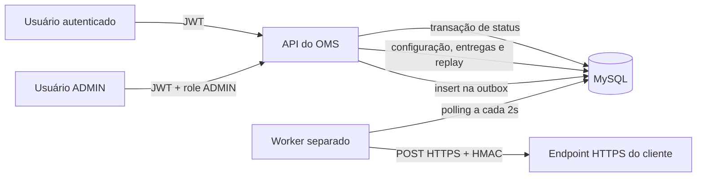
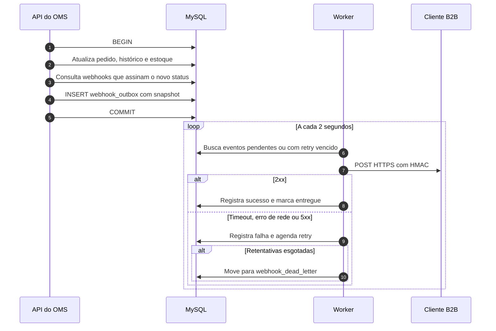

### HLD: Sistema de Webhooks de Notificação de Pedidos

**Versão:** 1.0

**Data:** 23/10/2026

**Responsável técnico:** Larissa (Tech Lead)

Classificação das informações: **Confirmado** para decisões declaradas ou aceitas na transcrição; **Hipótese** para interpretações técnicas plausíveis; **Pendente** para informações ou decisões não definidas.

---

### 1. Objetivo técnico

O objetivo é permitir que clientes B2B recebam notificações outbound quando o status de um pedido muda, substituindo o polling periódico em `GET /orders`. A solução deve notificar em tempo quase real, com latência percebida abaixo de 10 segundos, entrega confiável e mecanismos de segurança, diagnóstico e recuperação. [09:02] Marcos, [09:10] Larissa.

**Problemas técnicos abordados**

- O polling em `GET /orders` torna a integração lenta e cara para o cliente e não garante que toda mudança seja observada. [09:00] Marcos.
- O envio síncrono dentro da transação de `changeStatus` acoplaria a latência e a disponibilidade do cliente à mudança de status. Se o cliente estivesse fora do ar, não seria possível reverter a mudança de status apenas por causa da notificação. [09:04] Bruno, [09:06] Diego.
- Não existe mecanismo de eventos, fila, webhook ou histórico de entregas no OMS atual. [09:00] Marcos, [09:06] Diego.
- O cliente precisa validar a autenticidade do payload e se proteger de requisições forjadas ou adulteradas. [09:19] Sofia.
- Falhas de entrega precisam de retry, DLQ e replay manual, sem perda silenciosa de eventos. [09:15] Diego, [09:18] Diego.

**Sistemas e funcionalidades relacionados**

- API existente do OMS, autenticação JWT, módulo de pedidos, clientes e produtos.
- MySQL existente, acessado via Prisma Client.
- Serviço de pedidos, especialmente o método `changeStatus` e a máquina de estados.
- Novo worker em processo separado, com polling da outbox.
- Endpoints HTTPS dos clientes B2B.
- Portal do desenvolvedor, para documentação da integração. [09:26] Marcos, [09:40] Marcos.

**Limites do objetivo**

- A feature é somente outbound. O OMS envia eventos e não recebe webhooks do cliente. [09:02] Marcos, [09:03] Sofia.
- Não há dashboard visual, fallback por email, rate limiting de saída, garantia exactly-once, arquivamento de eventos, múltiplos workers ou ordering global nesta fase. [09:13] Larissa, [09:25] Diego, [09:37] Larissa, [09:39] Larissa, [09:40] Larissa.
- O `customerId` é explícito no body ou no path, não vem do JWT. [09:32] Larissa.
- O payload é um snapshot do pedido no momento da mudança de status e não inclui itens. [09:43] Diego, [09:52] Larissa.

**Critérios técnicos de sucesso**

- Entrega bem-sucedida em menos de 10 segundos em condição normal. [09:02] Marcos, [09:10] Larissa.
- Evento persistido na outbox se e somente se a transação de mudança de status confirmar. [09:06] Diego, [09:40] Bruno.
- Nenhum evento criado para status que nenhum webhook ativo do customer assina. [09:34] Bruno.
- Entrega at-least-once com `X-Event-Id` para deduplicação no cliente. [09:25] Diego, [09:26] Larissa.
- 100% das entregas com HTTPS e HMAC-SHA256. [09:20] Sofia, [09:23] Sofia.
- Falhas permanentes recuperáveis por replay manual de DLQ, restrito a ADMIN. [09:18] Diego, [09:36] Larissa.

---

### 2. Arquitetura geral

**Topologia**

A solução usa a API existente do OMS, um novo módulo de webhooks, um worker em processo separado, o MySQL existente e os endpoints HTTPS dos clientes. A API e o worker compartilham o mesmo banco, mas não o mesmo processo. [09:11] Diego, [09:11] Larissa, [09:30] Bruno.

**Camadas arquiteturais**

- **Apresentação e API:** endpoints REST autenticados sob `/api/v1`, com JWT, validação Zod, error middleware e logger Pino. [09:28] Bruno, [09:29] Bruno.
- **Domínio:** `OrderService.changeStatus` para a mudança de status, e o serviço de webhooks para configuração, rotação, consulta de entregas e replay. [09:40] Bruno, [09:41] Bruno.
- **Persistência:** MySQL via Prisma Client, com configuração de webhooks, outbox, histórico de entregas e DLQ. [09:06] Diego, [09:18] Diego.
- **Processamento assíncrono:** worker separado, em polling, responsável por entregar, aplicar retry e mover falhas para a DLQ. [09:09] Diego, [09:11] Diego.
- **Integração externa:** chamadas HTTP para endpoints HTTPS dos clientes, com HMAC-SHA256 e timeout. [09:20] Sofia, [09:42] Diego.

**Padrões arquiteturais**

- **Outbox transacional no MySQL:** o evento é inserido na mesma transação da mudança de status. [09:06] Diego, [09:40] Bruno.
- **Processamento assíncrono por polling:** o worker consulta a outbox a cada 2 segundos. [09:09] Diego.
- **Single-worker:** um único worker nesta fase, com ordering implícita por `order_id`. [09:12] Diego, [09:13] Larissa.
- **At-least-once com deduplicação:** o cliente deduplica pelo `X-Event-Id`. [09:25] Diego.
- **Retry com backoff e DLQ:** 1 tentativa inicial mais 5 retentativas, com backoff 1m/5m/30m/2h/12h e DLQ separada. [09:17] Larissa, [09:18] Diego.
- **Padrões do projeto:** `AppError`, Pino, error middleware, Zod, `requireRole` e estrutura modular existente. [09:28] Bruno, [09:30] Larissa.

**Tecnologias citadas**

| Tecnologia | Uso | Status |
| --- | --- | --- |
| MySQL | Persistência da outbox, configuração, entregas e DLQ; fonte de verdade. | Confirmado |
| Prisma Client | Acesso ao banco pela API e pelo worker, com instância separada por processo. | Confirmado |
| Node.js | Processo da API e processo separado do worker. | Confirmado |
| Pino | Logs estruturados reutilizados pela API e pelo worker. | Confirmado |
| JWT | Autenticação dos endpoints de configuração, consulta e replay. | Confirmado |
| Zod | Validação de schemas, incluindo a URL HTTPS. | Confirmado |
| HMAC-SHA256 | Assinatura do corpo das requisições outbound. | Confirmado |
| HTTPS/TLS | Transporte obrigatório para os endpoints dos clientes. | Confirmado |
| Framework HTTP e linguagem da API | Não nomeados na transcrição. O HLD não assume uma escolha. | Não informado na transcrição |

**Ambiente de implantação**

Não informado na transcrição. A reunião menciona a infraestrutura existente, processos Node e a possibilidade de subir Redis Cluster, mas não define cloud, on-premises ou híbrido. [09:07] Diego.

**Diagrama de arquitetura**

---

### 3. Componentes e responsabilidades

| Componente | Responsabilidades | Dependências | Status |
| --- | --- | --- | --- |
| API existente do OMS | Expor endpoints REST autenticados, validar entrada, aplicar error middleware, montar rotas sob `/api/v1` e responder às operações de configuração, consulta e replay. | JWT, Zod, Pino, MySQL, módulo de webhooks. | Confirmado |
| Módulo de webhooks | Concentrar controller, service, repository, routes e schemas do domínio de webhooks, seguindo o padrão modular existente. | API, MySQL, `AppError`, Pino. | Confirmado (módulo); Hipótese (estrutura interna) |
| `OrderService.changeStatus` | Validar a transição, atualizar o pedido, registrar histórico, ajustar estoque e inserir o evento na outbox dentro da mesma transação. | MySQL, máquina de estados, `publishWebhookEvent`. | Confirmado |
| `publishWebhookEvent(tx, order, fromStatus, toStatus)` | Filtrar webhooks elegíveis, renderizar o snapshot e, por hipótese de modelagem, inserir uma linha por webhook na outbox, usando o client transacional. | Transação de `changeStatus`, configuração de webhooks, MySQL. | Confirmado (nome e uso do `tx`); Hipótese (tipos exatos) |
| `webhook_outbox` | Persistir eventos pendentes, status de processamento, tentativas, próximo retry e payload snapshot. | MySQL, worker. | Confirmado (nome); Hipótese (schema) |
| Worker em `src/worker.ts` | Consultar a outbox em polling, entregar HTTP, aplicar retry, mover falhas para a DLQ e manter processo separado da API. | MySQL, Prisma Client próprio, HMAC, HTTPS, Pino. | Confirmado (novo processo); Hipótese (implementação) |
| `webhook_dead_letter` | Armazenar eventos que esgotaram as tentativas, com payload, motivo e timestamp, para diagnóstico e replay. | MySQL, worker, endpoint ADMIN. | Confirmado (tabela separada); Hipótese (schema) |
| Configuração de webhooks | Armazenar customer, URL, secret, estado ativo e lista de status assinados por endpoint. | MySQL, API. | Confirmado (conceito); Hipótese (tabela e modelo) |
| Histórico de entregas | Registrar as últimas 100 tentativas de entrega por endpoint, com sucesso ou falha, payload, resposta e duração. | MySQL, worker, API. | Confirmado (conceito); Hipótese (schema) |
| Endpoint HTTPS do cliente | Receber a requisição, validar a assinatura HMAC-SHA256 e deduplicar pelo `X-Event-Id`. | HTTPS, HMAC, implementação do cliente. | Confirmado (externo) |
| MySQL | Ser a fonte de verdade para configuração, outbox, entregas e DLQ. | Nenhuma dependência interna. | Confirmado |
| Pino e observabilidade | Produzir logs estruturados. Métricas, tracing, dashboards e alertas não foram definidos. | API, worker. | Confirmado (Pino); Pendente (métricas e tracing) |
| Endpoint de replay de DLQ | Recolocar um evento da DLQ na outbox como pendente, restrito a ADMIN e auditado. | Autenticação, `requireRole`, DLQ, outbox. | Confirmado |
| Portal do desenvolvedor | Documentar payload, headers, HMAC, deduplicação, retry e rotação para os clientes. | Time de produto e documentação. | Confirmado (dependência organizacional) |

---

### 4. Fluxo de requisições e de dados

**4.1 Cadastro e configuração de webhook**

1. Um usuário autenticado chama um endpoint de configuração com JWT válido.
2. A API valida o body, o `customerId` explícito, a URL HTTPS e a lista de status assinados.
3. Hipótese de validação: a API verifica a existência do customer. A API gera uma secret única para o endpoint.
4. A configuração é persistida com customer, URL, secret vigente, estado ativo e status assinados.
5. A secret é devolvida na criação. A exposição posterior da secret é uma hipótese de segurança a confirmar. [09:21] Sofia, [09:31] Marcos, [09:32] Larissa, [09:23] Sofia.

**4.2 Mudança de status e criação do evento**

1. A API recebe a mudança de status existente no serviço de pedidos.
2. `OrderService.changeStatus` abre a transação, valida a transição, atualiza o pedido, insere o histórico e ajusta o estoque. [09:04] Bruno.
3. Dentro da mesma transação, `publishWebhookEvent(tx, order, fromStatus, toStatus)` consulta os webhooks ativos do customer que assinam o status de destino. [09:41] Bruno.
4. Se nenhum webhook for elegível, nenhum evento é inserido. [09:34] Bruno.
5. Para cada webhook elegível, a função renderiza o snapshot com `event_id`, `event_type`, timestamp ISO 8601, `order_id`, `order_number`, `from_status`, `to_status`, `customer_id` e `total_cents`. [09:43] Diego.
6. Hipótese de modelagem: a função insere uma linha na `webhook_outbox` por webhook elegível, com status pendente e tentativas zeradas.
7. A transação confirma apenas se a mudança de status e a inserção na outbox forem bem-sucedidas. Qualquer falha reverte tudo. [09:40] Bruno, [09:41] Diego.

**4.3 Processamento e entrega pelo worker**

1. O worker roda em processo separado da API e consulta a outbox a cada 2 segundos. [09:09] Diego, [09:11] Diego.
2. O worker busca eventos pendentes ou aguardando retry, em lote pequeno, priorizando os mais antigos. [09:08] Diego.
3. Para cada evento, carrega a configuração do webhook e a secret vigente, calcula o HMAC-SHA256 sobre o corpo bruto e monta os headers. [09:20] Sofia, [09:44] Diego.
4. O worker envia a requisição para a URL HTTPS do cliente e aguarda até 10 segundos. [09:42] Diego.
5. Resposta 2xx marca o evento como entregue. Timeout, erro de rede ou resposta 5xx seguem para retry. Resposta 4xx é falha, com política de retry pendente. [09:42] Diego.
6. O worker registra cada tentativa no histórico de entregas, com sucesso ou falha, payload, resposta, status HTTP e duração. [09:34] Marcos.

**4.4 Retry e DLQ**

1. A progressão de backoff é 1 minuto, 5 minutos, 30 minutos, 2 horas e 12 horas. [09:17] Diego.
2. A leitura adotada nos documentos derivados é 1 tentativa inicial mais 5 retentativas, totalizando até 6 chamadas HTTP. Essa leitura é a única que usa o intervalo de 12 horas e fecha a janela de quase 15 horas citada na reunião. A transcrição literal diz 5 tentativas, o que gera uma contradição registrada. [09:15] Diego, [09:17] Diego.
3. Após a 5ª retentativa falhar, o evento é movido para `webhook_dead_letter` com payload, motivo, timestamp e identificadores, e removido da fila ativa. [09:18] Diego.
4. O replay manual recoloca o evento na outbox como pendente, exige role ADMIN e registra quem executou a operação. [09:18] Diego, [09:36] Larissa, [09:36] Sofia.

**4.5 Rotação de secret**

1. O cliente autenticado solicita uma nova secret para o endpoint.
2. A nova secret passa a ser a vigente e a anterior permanece válida por 24 horas para permitir a migração. [09:21] Sofia, [09:22] Sofia.
3. O formato de convivência das duas secrets no header `X-Signature` não foi definido. [09:22] Sofia.

**4.6 Consulta de histórico e replay**

1. O cliente autenticado consulta as últimas 100 tentativas de entrega de um webhook, da mais recente para a mais antiga. Hipótese: cada tentativa HTTP é uma linha do histórico. [09:34] Marcos.
2. A resposta inclui sucesso ou falha, payload, resposta do cliente e tempo de resposta.
3. O replay de DLQ é uma operação administrativa, restrita a ADMIN, que recoloca o evento na outbox e registra auditoria. [09:18] Diego, [09:36] Sofia.

**Comunicação síncrona e assíncrona**

- Cadastro, edição, remoção, rotação, consulta de entregas e replay são operações síncronas da API. [09:31] Marcos, [09:33] Bruno.
- A entrega ao cliente é assíncrona, desacoplada por outbox e worker. [09:06] Diego.
- Não há fila externa, stream ou broker nesta fase. O MySQL é a persistência e o mecanismo de desacoplamento. [09:07] Diego.

**Validações e transformações**

- URL somente HTTPS; HTTP é recusado. [09:23] Sofia.
- Status validados contra o enum de status do pedido. [09:33] Bruno.
- Payload renderizado no momento da inserção e imutável depois. [09:52] Larissa.
- Payload máximo de 64KB, sem truncamento. O estágio exato de validação está pendente. [09:23] Sofia, [09:24] Diego.
- HMAC-SHA256 calculado sobre o corpo bruto da requisição. [09:20] Sofia.
- Deduplicação no cliente pelo `X-Event-Id`. [09:25] Diego.

**Diagrama de sequência de alto nível**

---

### 5. Modelo de dados em alto nível

O MySQL é a fonte de verdade. Não há cache, replicação ou sincronização definida na transcrição.

| Entidade | Papel | Atributos principais | Relacionamentos | Status |
| --- | --- | --- | --- | --- |
| Customer | Cliente B2B existente, dono dos webhooks. | Identificador, dados cadastrais. | 1:N webhook endpoints. | Confirmado (entidade existente) |
| Webhook endpoint | Configuração de um endpoint de webhook. | `id`, `customer_id`, `url`, secret vigente, secret anterior, expiração da anterior, `active`, timestamps. | N:1 customer; 1:N assinaturas, eventos, entregas e DLQ. | Confirmado (conceito); Hipótese (tabela e campos) |
| Webhook subscription | Lista de status que um endpoint assina. | `webhook_id`, `status`. | N:1 webhook endpoint. | Confirmado (conceito); Hipótese (modelo normalizado ou JSON) |
| Webhook outbox | Fila persistente de eventos a entregar. | `id` UUID, `event_id` UUID, `webhook_id`, `order_id`, payload JSON, status, tentativas, próximo retry, timestamps. | N:1 webhook endpoint; N:1 order. | Confirmado (tabela); Hipótese (schema) |
| Webhook delivery | Histórico de cada tentativa de entrega. | `id`, `outbox_id`, `webhook_id`, `event_id`, tentativa, sucesso ou falha, status HTTP, resposta, duração, timestamp. | N:1 webhook endpoint; N:1 outbox. | Confirmado (conceito); Hipótese (tabela e campos) |
| Webhook dead letter | Eventos que esgotaram as tentativas. | `id`, `event_id`, `webhook_id`, payload, motivo da falha, tentativas, última resposta, timestamp. | N:1 webhook endpoint. | Confirmado (tabela separada); Hipótese (schema) |
| Order | Pedido existente, origem dos dados do evento. | Identificador, número, status, customer, total. | 1:N eventos na outbox. | Confirmado (entidade existente) |

**Fonte de verdade e consistência**

- A outbox é gravada na mesma transação da mudança de status, garantindo que o evento exista se e somente se a mudança for confirmada. [09:06] Diego, [09:40] Bruno.
- O payload é um snapshot imutável do estado do pedido no momento da mudança. [09:52] Larissa.
- O `X-Event-Id` é gerado quando o evento entra na outbox. Hipótese: o mesmo `event_id` é preservado em retries e replay. [09:25] Diego.
- A entrega é at-least-once; duplicatas são esperadas e o cliente deduplica pelo `X-Event-Id`. [09:25] Diego.

**Cache, versionamento e retenção**

- Cache: não informado na transcrição.
- Versionamento do payload: não há campo de versão; a inclusão de versionamento está pendente.
- Retenção do histórico: últimas 100 tentativas por endpoint; não há política de retenção de longo prazo definida.
- Arquivamento da outbox após 30 dias: fora do escopo desta feature. [09:08] Diego.
- DLQ: mantida até replay manual; a remoção após replay não foi definida. [09:18] Diego.

**Lacunas e decisões pendentes do modelo**

- Nomes das tabelas de configuração e de histórico de entregas: propostas, não confirmados na transcrição.
- Lista de status assinados: tabela normalizada ou coluna JSON; a escolha não foi definida.
- Relação entre o `id` da linha da outbox e o `event_id`: a separação é uma hipótese de modelagem.
- Comportamento de chave estrangeira com `orders`: não definido; uma FK com cascade poderia remover eventos ainda necessários.
- Criptografia e formato da secret em repouso: não definidos.
- Estágio de validação do limite de 64KB: inserção, envio ou ambos; pendente.
- Política de retry para 4xx: pendente.
- Semântica de replay: remoção da DLQ, reset de tentativas e preservação do `event_id`; pendente.

---

### 6. Interfaces públicas

As rotas exatas de alguns endpoints não foram ditadas na transcrição. Quando o método foi confirmado e o caminho é uma proposta, o status indica essa distinção. Proposta: a listagem adota o `customerId` no path para manter a decisão de que o cliente é explícito no body ou no path. [09:32] Larissa.

| Nome | Tipo | Protocolo | Exposição | SLAs/Limites | Status |
| --- | --- | --- | --- | --- | --- |
| `POST /api/v1/webhooks` | API | HTTPS/JSON | Externa, autenticada | JWT; body limitado pelo middleware existente; sem SLA definido | Confirmado (método e conceito); Hipótese (caminho e campos) |
| `GET /api/v1/customers/:customerId/webhooks` | API | HTTPS/JSON | Externa, autenticada | JWT; paginação não definida; sem SLA definido | Hipótese (caminho); Confirmado (listagem por customer) |
| `PATCH /api/v1/webhooks/:id` | API | HTTPS/JSON | Externa, autenticada | JWT; sem SLA definido | Confirmado (método); Hipótese (caminho e campos) |
| `DELETE /api/v1/webhooks/:id` | API | HTTPS/JSON | Externa, autenticada | JWT; sem SLA definido | Confirmado (método); Hipótese (caminho e comportamento de exclusão) |
| `POST /api/v1/webhooks/:id/rotate-secret` | API | HTTPS/JSON | Externa, autenticada | JWT; grace period de 24h; sem SLA definido | Hipótese (caminho); Confirmado (rotação e grace period) |
| `GET /api/v1/webhooks/:id/deliveries` | API | HTTPS/JSON | Externa, autenticada | JWT; últimas 100 tentativas; sem paginação definida | Confirmado (caminho e limite); Hipótese (formato da resposta) |
| `POST /api/v1/admin/webhooks/dead-letter/:id/replay` | API | HTTPS/JSON | Externa, autenticada, role ADMIN | JWT + `requireRole('ADMIN')`; auditoria; sem SLA definido | Confirmado (caminho, role e auditoria); Hipótese (status HTTP e resposta) |
| `publishWebhookEvent(tx, order, fromStatus, toStatus)` | Função interna | Chamada em processo | Interna | Executa dentro da transação de `changeStatus`; sem SLA | Confirmado (nome e uso do `tx`); Hipótese (tipos e retorno) |
| Webhook outbound para o cliente | API/HTTP | HTTPS/JSON | Externa | Timeout de 10s; payload máximo de 64KB; at-least-once; 1 tentativa inicial + 5 retentativas | Confirmado (headers, payload, timeout e garantia); Hipótese (método POST e formato da assinatura) |

**Semântica e limites gerais**

- Todas as APIs de configuração, consulta e replay exigem JWT Bearer. O replay exige ADMIN. [09:36] Larissa.
- O CRUD de configuração e a consulta de entregas não exigem role específica nesta fase. [09:37] Sofia.
- A URL do webhook deve ser HTTPS; HTTP é rejeitado. [09:23] Sofia.
- Os headers outbound são `X-Signature`, `X-Timestamp`, `X-Webhook-Id`, `X-Event-Id` e `Content-Type: application/json`. [09:44] Diego, [09:44] Sofia.
- A assinatura é HMAC-SHA256 sobre o corpo bruto, com secret única por endpoint. [09:20] Sofia, [09:21] Sofia.
- O formato da assinatura, o formato do `X-Timestamp` e a convivência de duas secrets na rotação estão pendentes. [09:22] Sofia, [09:44] Diego.
- Não há rate limiting de saída nesta fase. [09:39] Larissa.
- Não há SLA de disponibilidade definido na transcrição.

---

### 7. Escalabilidade, resiliência e disponibilidade

**Escalabilidade**

- O worker é único nesta fase. A ordering é implícita por `order_id` e não há garantia global. [09:12] Diego, [09:13] Larissa.
- O polling ocorre a cada 2 segundos, com leitura de eventos pendentes em lote pequeno. [09:09] Diego.
- A outbox tem índices em status e `created_at` para sustentar a consulta do worker. [09:08] Diego.
- Não foram definidos cache, particionamento, balanceamento de carga ou múltiplos workers nesta fase.
- A evolução para múltiplos workers exigiria particionamento por `order_id` ou lock pessimista, conforme mencionado, mas não foi decidida. [09:13] Diego.
- O tamanho do lote, o limite de backlog e a política de escala não foram definidos. **Pendente**.

**Resiliência**

- Atomicidade transacional entre mudança de status e outbox. [09:06] Diego, [09:40] Bruno.
- Timeout de 10 segundos por chamada HTTP. [09:42] Diego.
- Retry com 1 tentativa inicial mais 5 retentativas, backoff 1m/5m/30m/2h/12h. [09:17] Larissa.
- Falhas permanentes são persistidas em `webhook_dead_letter` e podem ser reprocessadas manualmente por ADMIN. [09:18] Diego, [09:36] Larissa.
- Garantia at-least-once com deduplicação no cliente pelo `X-Event-Id`. [09:25] Diego.
- Worker separado da API, o que evita perder o processamento quando a API reinicia. [09:11] Diego.
- Reinício do worker não perde eventos persistidos na outbox, mas o mecanismo de recuperação de linhas presas em processamento não foi definido. [09:11] Diego.
- Não foram definidos circuit breaker, rate limiting de saída ou fallback por email nesta fase. [09:37] Larissa, [09:39] Larissa.

**Disponibilidade**

- Não há meta de disponibilidade, SLA ou SLO definido na transcrição. **Pendente**.
- O worker único é um ponto único de processamento. A outbox evita perda de eventos, mas não garante entrega durante a indisponibilidade do worker. [09:11] Diego.
- A API e o worker dependem do MySQL existente. A indisponibilidade do banco afeta a mudança de status e o processamento. **Hipótese** de dependência crítica.

**Ordering**

- Há ordering por `order_id` enquanto houver um único worker e processamento sequencial. [09:12] Diego.
- Não há ordering global. [09:13] Larissa.
- Um retry atrasado pode permitir que um evento posterior do mesmo pedido ultrapasse o anterior. Essa contradição não foi resolvida na transcrição. **Pendente**.

**Contradições e lacunas relevantes**

- A transcrição diz 5 tentativas e lista 5 intervalos. Os documentos derivados adotam 1 tentativa inicial mais 5 retentativas, mas a transcrição literal não fecha essa contagem. [09:15] Diego, [09:17] Diego.
- A ordering por `order_id` é afirmada com single-worker, mas o retry pode quebrar a ordem. [09:12] Diego, [09:17] Diego.
- O grace period de 24 horas para a secret anterior não define como as duas secrets convivem no header. [09:22] Sofia.
- A política de retry para 4xx não foi definida. **Pendente**.
- O comportamento para webhook inativo ou removido entre a inserção e a entrega não foi definido. **Pendente**.
- O mecanismo de recuperação de eventos presos em processamento após falha do worker não foi definido. **Pendente**.

**Metas e limites explicitamente citados**

| Item | Valor | Status |
| --- | --- | --- |
| Latência percebida pelo cliente | Abaixo de 10 segundos | Confirmado como expectativa do cliente |
| Polling do worker | 2 segundos | Confirmado |
| Timeout HTTP | 10 segundos | Confirmado |
| Payload máximo | 64KB, sem truncamento | Confirmado |
| Retry | 1 tentativa inicial + 5 retentativas, backoff 1m/5m/30m/2h/12h | Confirmado na decisão; contagem literal da transcrição é ambígua |
| Grace period de rotação | 24 horas | Confirmado |
| Histórico de entregas | Últimas 100 tentativas | Confirmado como limite; interpretação de tentativa é hipótese |
| Disponibilidade | Não informada | Pendente |

---

### 8. Segurança

**Autenticação e autorização**

- Todos os endpoints da feature exigem JWT Bearer, usando o middleware de autenticação existente. [09:28] Bruno.
- O CRUD de configuração e a consulta de entregas permitem qualquer role autenticada nesta fase. [09:37] Sofia.
- O replay de DLQ exige role ADMIN via `requireRole`. [09:36] Larissa, [09:36] Sofia.
- O `customerId` é explícito no body ou no path; não é derivado do JWT. [09:32] Larissa.
- O isolamento por customer além da autenticação não foi definido. Um usuário autenticado pode gerenciar webhooks de qualquer customer, dependendo do modelo de usuários. **Pendente** e risco de autorização.

**Gestão de segredos**

- Cada endpoint de webhook tem uma secret única, gerada pela API e devolvida na criação. [09:21] Sofia, [09:31] Marcos.
- A secret é rotacionável, e a anterior permanece válida por 24 horas. [09:21] Sofia, [09:22] Sofia.
- O formato, o tamanho, a codificação e a criptografia da secret em repouso não foram definidos. **Pendente**.
- A secret precisa ser recuperável pela API e pelo worker para calcular o HMAC; hash de mão única não atende. **Hipótese**.
- A não exposição da secret em logs e em respostas de listagem é uma hipótese de segurança, não uma decisão confirmada. [09:22] Sofia.

**Criptografia e transporte**

- A URL do webhook deve usar HTTPS. HTTP é recusado na validação. [09:23] Sofia.
- A versão mínima de TLS, as cifras e a validação de certificado do cliente não foram definidas. **Pendente**.
- O HMAC-SHA256 é calculado sobre o corpo da requisição com a secret do endpoint. [09:20] Sofia.
- O formato do valor de `X-Signature` e a inclusão ou não do timestamp no cálculo não foram definidos. **Pendente**.
- O `X-Timestamp` existe para o cliente detectar replay, mas o formato não foi definido. [09:44] Diego.

**Proteção de dados**

- O payload contém dados básicos do pedido e `customer_id`, sem itens. [09:43] Diego.
- A classificação de dados pessoais, a necessidade de mascaramento e a retenção do payload não foram discutidas. **Pendente**.
- O histórico de entregas armazena a resposta do cliente, que pode conter dados sensíveis ou conteúdo grande. Truncamento, redaction e retenção não foram definidos. **Pendente**.
- O replay de DLQ gera registro de auditoria com usuário, timestamp e identificadores. O Pino é o mínimo confirmado; a necessidade de trilha imutável em tabela não foi discutida. [09:36] Sofia.

**Riscos de segurança não decididos**

- SSRF por URL fornecida pelo cliente: não discutido. **Hipótese** de risco; exige validação de destinos, bloqueio de redes privadas e tratamento de redirects.
- Vazamento de secret em logs: já houve incidente com cliente, segundo a reunião. A redaction do Pino para secrets precisa ser implementada. [09:22] Sofia.
- Autorização sem isolamento por customer: risco arquitetural pendente.
- Assinatura sem formato definido: risco de interoperabilidade e de falha na validação do cliente.

---

### 9. Observabilidade

**Logs**

- A solução reutiliza o Pino existente, sem introduzir uma nova biblioteca de logs. [09:29] Bruno.
- Hipótese de instrumentação: incluir, no mínimo, `event_id`, `webhook_id`, `order_id`, tentativa, status HTTP, duração e resultado. [09:29] Bruno.
- **Hipótese:** reutilizar os campos de correlação do logger existente, como `requestId` e `userId`, no módulo de webhooks.
- Secrets, assinaturas e payloads completos não devem ser logados. A redaction atual precisa ser estendida. **Hipótese** de implementação.
- A auditoria do replay deve registrar o usuário ADMIN, o timestamp, o evento e o resultado. [09:36] Sofia.

**Métricas**

- Não foram definidas na transcrição. **Pendente**.
- Propostas a validar: eventos pendentes na outbox, idade do evento mais antigo, sucesso e falha de entrega, retentativas, tamanho da DLQ, latência de entrega, duração do polling e heartbeat do worker.
- A escolha da biblioteca ou do padrão de métricas não foi definida. **Hipótese**.

**Tracing**

- Não foi definido na transcrição. A reunião confirma o reuso do Pino para logs, mas não discute tracing. **Pendente**.
- Proposta a validar: spans para enfileiramento na outbox, ciclo do worker, tentativa de entrega e replay.
- A propagação de contexto para o cliente e a política de amostragem não foram definidas. **Hipótese**.

**Dashboards e alertas**

- Não foram definidos na transcrição. **Pendente**.
- Propostas a validar: backlog da outbox, evento mais antigo pendente, taxa de falha por cliente, tamanho da DLQ, latência p95/p99 e ausência de heartbeat do worker.
- Os limites numéricos de alerta não foram definidos. **Pendente**.

**SLOs e SLAs**

- A única meta quantificada é a latência abaixo de 10 segundos em condição normal. [09:02] Marcos, [09:10] Larissa.
- Não há SLO de disponibilidade, taxa de sucesso ou tempo de recuperação definido. **Pendente**.

---

### 10. Riscos arquiteturais e mitigação

As probabilidades e os impactos são estimativas técnicas. A transcrição não quantificou esses valores.

| Risco | Origem | Probabilidade | Impacto | Mitigação | Contingência |
| --- | --- | --- | --- | --- | --- |
| Reordenação de eventos do mesmo `order_id` durante retry | Contradição entre a ordering por `order_id` e o backoff; hipótese de falha | Média | Alto: o cliente pode receber um status posterior antes do anterior | Serializar eventos por `order_id`, bloquear eventos posteriores enquanto houver anterior pendente ou documentar a limitação | Reconciliar os eventos e orientar o cliente a consultar o pedido atual |
| Worker único como ponto único de falha e acúmulo de backlog | Decisão explícita de single-worker; risco inferido | Média | Alto: atraso de entregas e crescimento da outbox | Processo separado, supervisão, índices, monitoramento de backlog e heartbeat | Reiniciar o worker, processar o backlog e avaliar escala futura |
| Falha na outbox bloquear a mudança de status | Decisão explícita de atomicidade; risco inferido | Baixa | Alto: a operação principal depende da inserção do evento | Testes de rollback, insert simples, payload pequeno e monitoramento de erros | Investigar, corrigir a causa e repetir a mudança de status |
| Rotação de secret sem formato de convivência definido | Lacuna explícita na transcrição | Alta | Médio: a validação HMAC pode quebrar durante a rotação | Definir o formato de `X-Signature` e o mecanismo de duas secrets; testar com cliente simulado | Adiar a rotação, manter a secret anterior ou desativar o endpoint |
| Vazamento de secret | Preocupação explícita da segurança | Média | Alto: terceiros podem forjar requisições | Secret por endpoint, HMAC, HTTPS, redaction de logs e rotação | Rotacionar a secret, desativar o endpoint e investigar acessos |
| SSRF por URL fornecida pelo cliente | Hipótese, não discutida na reunião | Média | Alto: acesso a serviços internos ou metadata | HTTPS, bloqueio de IPs privados, validação de DNS, não seguir redirects e egress controlado | Desativar o endpoint, bloquear o destino e revisar URLs cadastradas |
| Duplicidade de entrega não tratada pelo cliente | Garantia at-least-once confirmada; risco inferido | Média | Médio: efeitos duplicados no sistema do cliente | `X-Event-Id` estável, documentação de deduplicação e preservação do ID em retries e replay | Suporte orienta deduplicação e revisão da idempotência do receptor |
| Crescimento das tabelas sem arquivamento | Arquivamento explicitamente fora de escopo | Média | Médio: custo e degradação de consultas | Índices, monitoramento de tamanho e planejamento futuro de retenção | Limpeza ou arquivamento manual em janela de manutenção |
| Múltiplos workers iniciados por engano | Decisão explícita de single-worker; risco inferido | Baixa | Alto: duplicidade e perda de ordering | Garantir uma instância no deploy, documentar a limitação e prever lock no futuro | Parar instâncias extras e reconciliar eventos |
| Política de retry para 4xx indefinida | Lacuna explícita na transcrição | Média | Médio: erro permanente pode consumir a janela de retry ou ir para DLQ sem necessidade | Definir a política antes da implementação; considerar 4xx como falha permanente | Replay manual após correção do cliente |
| Autorização sem isolamento por customer | Decisão de qualquer role autenticada; risco inferido | Média | Alto: usuário pode gerenciar webhooks de outro customer | Revisar o modelo com a segurança, auditar operações e restringir roles no futuro | Restringir acessos e auditar configurações existentes |
| Formato da assinatura HMAC indefinido | Lacuna explícita na transcrição | Média | Médio: clientes não conseguem validar a assinatura de forma interoperável | Definir codificação, prefixo e inclusão ou não do timestamp; publicar exemplo e testar | Suporte conjunto com o cliente e ajuste do contrato |
| Ausência de SLO de disponibilidade | Lacuna explícita na transcrição | Média | Médio: não há critério objetivo para operar e alertar | Definir SLO e metas de recuperação com a operação | Operação reativa e comunicação manual até a definição |

---

### 11. ADRs e próximos passos

**ADRs e decisões já registradas**

A transcrição não registra ADRs formais. As decisões abaixo são candidatas a ADR e já estão fechadas na transcrição:

- Adotar outbox transacional no MySQL em vez de envio síncrono ou fila externa. [09:06] Diego, [09:07] Diego.
- Executar o worker em processo separado, com polling a cada 2 segundos e single-worker. [09:09] Diego, [09:11] Diego.
- Aplicar retry com backoff 1m/5m/30m/2h/12h e DLQ em tabela separada. [09:17] Larissa, [09:18] Diego.
- Assinar o corpo com HMAC-SHA256, com secret única por endpoint e rotação com grace period de 24 horas. [09:20] Sofia, [09:21] Sofia, [09:22] Sofia.
- Garantir at-least-once com `X-Event-Id` para deduplicação no cliente. [09:25] Diego, [09:26] Larissa.
- Filtrar os status na inserção da outbox e renderizar o payload como snapshot imutável. [09:34] Bruno, [09:52] Larissa.
- Reutilizar `AppError`, Pino, error middleware, Zod, `requireRole` e o padrão modular existente. [09:28] Bruno, [09:29] Larissa.
- Limitar o payload a 64KB e o timeout HTTP a 10 segundos. [09:24] Larissa, [09:42] Diego.
- Exigir ADMIN e auditoria no replay de DLQ. [09:36] Larissa, [09:36] Sofia.
- Usar UUID como identificador da outbox. [09:51] Larissa.
- Não adotar Redis Streams, fila externa, trigger de banco, envio síncrono, exactly-once, webhooks inbound, fallback por email, rate limiting de saída, dashboard visual, arquivamento após 30 dias ou múltiplos workers nesta fase. [09:02] Marcos, [09:07] Diego, [09:09] Diego, [09:25] Diego, [09:37] Larissa, [09:39] Larissa, [09:40] Larissa, [09:13] Larissa, [09:08] Diego.

**Decisões pendentes**

- Formato e codificação de `X-Signature`, incluindo prefixo e eventual inclusão do timestamp.
- Formato de `X-Timestamp`.
- Mecanismo de convivência das duas secrets durante as 24 horas de rotação.
- Semântica do `event_id` entre múltiplos endpoints e no replay.
- Comportamento para webhook inativo ou removido entre a inserção e a entrega.
- Recuperação de eventos presos em processamento após falha do worker.
- Política de retry para 4xx.
- Estágio de validação do limite de 64KB, na inserção, no envio ou em ambos.
- Formato, tamanho, codificação e criptografia da secret em repouso.
- Isolamento de autorização por customer.
- Controles de SSRF e política de redirects.
- Retenção do histórico de entregas e truncamento da resposta do cliente.
- Semântica de replay: remoção da DLQ, reset de tentativas e preservação do `event_id`.
- Tamanho do lote, configuração por ambiente e proteção contra múltiplos workers.
- Versionamento do payload.
- Rotas exatas, nomes de campos e formatos de resposta dos endpoints de configuração e rotação.
- Métricas, tracing, dashboards e alertas.
- SLO de disponibilidade e metas de recuperação.
- Mecanismo de deploy e supervisão do worker.

**Lacunas de informação**

- Ambiente de implantação: cloud, on-premises ou híbrido não informado.
- Framework HTTP e linguagem da API não nomeados na transcrição.
- Versão do MySQL e do Prisma não informadas na transcrição.
- Formato, tamanho e codificação da secret não definidos.
- Formato da assinatura HMAC e do timestamp não definidos.
- Formato exato das respostas HTTP dos endpoints não definido.
- Método HTTP do webhook outbound não explicitado; POST é uma inferência.
- A transcrição fala em `últimos 100 webhooks`; a leitura adotada é `últimas 100 tentativas de entrega`, uma hipótese.
- A transcrição diz 5 tentativas e lista 5 intervalos; os documentos derivados adotam 1 tentativa inicial mais 5 retentativas. A contradição está registrada.
- Política de 4xx, SSRF, isolamento por customer e disponibilidade não foram discutidos.
- Rate limiting de saída foi adiado e não tem critério de decisão definido.

**Próximos passos técnicos**

1. Formalizar os ADRs das decisões já fechadas e registrar as pendências.
2. Consolidar o RFC e o FDD com os contratos, fluxos e critérios de aceite.
3. Fechar com a segurança o formato da assinatura, a rotação, o armazenamento da secret e os controles de SSRF.
4. Definir a política de 4xx, a semântica de replay e o comportamento de endpoints inativos.
5. Definir métricas, tracing, dashboards, alertas e SLO de disponibilidade.
6. Modelar e migrar as tabelas de configuração, outbox, entregas e DLQ.
7. Implementar o módulo de webhooks, a integração com `changeStatus` e o worker separado.
8. Cobrir os fluxos com testes de integração, contrato, segurança e carga.
9. Reservar pelo menos dois dias úteis para a revisão de segurança da Sofia antes do deploy. [09:46] Sofia.
10. Atualizar o portal do desenvolvedor com payload, headers, HMAC, deduplicação, retry, DLQ e rotação. [09:26] Marcos.
11. Executar a entrega em três sprints, incluindo a revisão de segurança. [09:46] Larissa.
